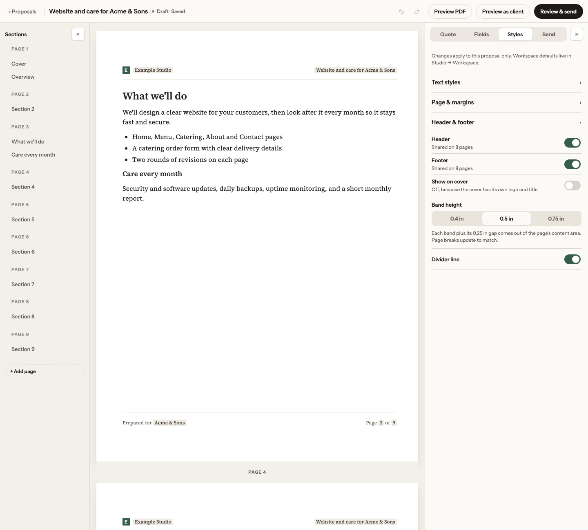
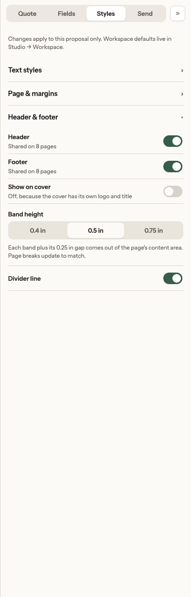
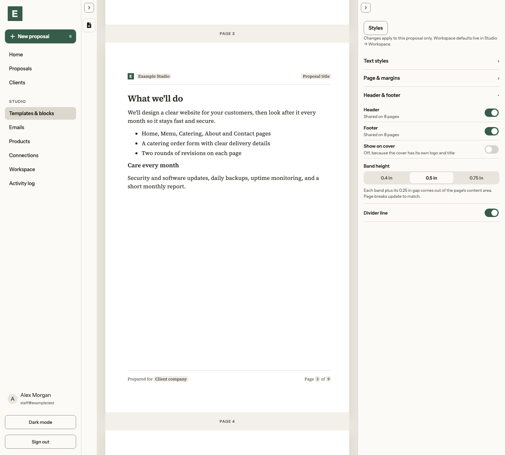
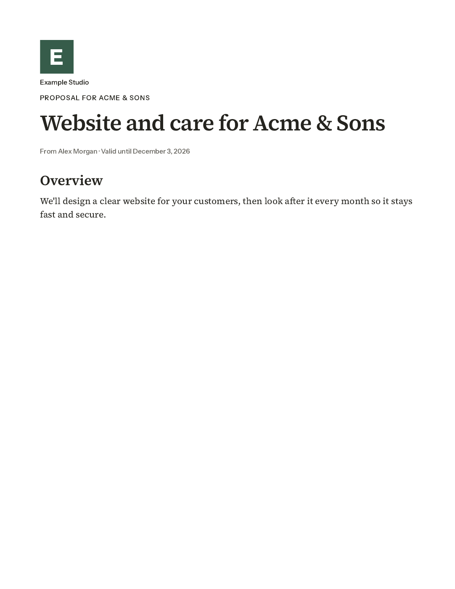
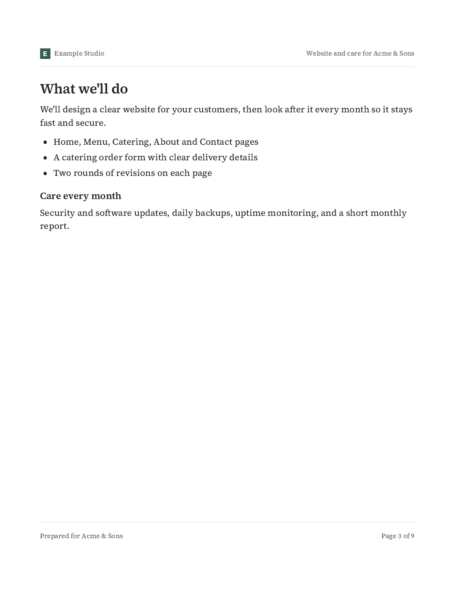
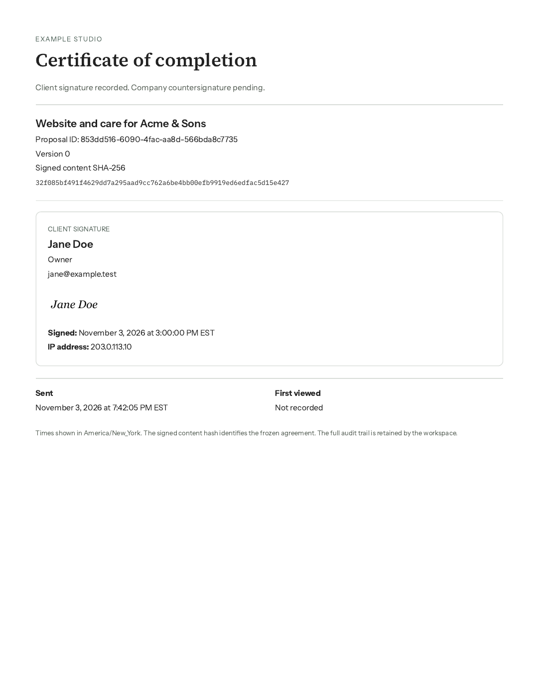

# Header/footer foundation — PR #58

Reference: Redesign 13 frames 1a, 1i, 3a and the spec card, with the owner decisions taking precedence. The screenshot fixture is neutral Example Studio / Acme & Sons data, with nine proposal pages and a synthetic test signature. Editor screenshots are 1440 × 1300 in light mode. PDF images are rendered from the app's actual sealing pipeline with Poppler.

Page 1 has no bands by default. Page 3 has 0.75in margins, 0.5in bands and 24px band-to-content gaps: its canonical content area is 672 × 768px. Its footer reads Page 3 of 9. The appended certificate is not counted and has no bands. Narrow editor sheets retain responsive full-size text; their canonical geometry and source plan remain Letter-sized.

| Editor | Image |
| --- | --- |
| Shared bands and Styles at 1440px |  |
| Styles group detail (same viewport) |  |
| Template shared bands and Styles at 1440px |  |

| PDF page | Image |
| --- | --- |
| 1 — cover, bands off |  |
| 3 — shared header/footer, Page 3 of 9 |  |
| 10 — completion certificate, no bands |  |

No owner export, live customer data or provider credentials are included. No hosted resources or migration are needed. Client web sheets, interactive band controls and per-page overrides remain later PRs.

## Verification

Full browser suite: 147 passed, three optional captures skipped (12.2 minutes). Final Styles-focused checks: 20 passed. Unit/database tests: 318 passed in 54 files. TypeScript, formatting, neutrality, production build and PDF runtime tracing (328 API files) passed. The six new/existing PDF-focused checks also passed in an isolated Ubuntu 24.04 / Poppler 24.02 container. The lossless layout test includes 300 retained paragraphs across three columns.
