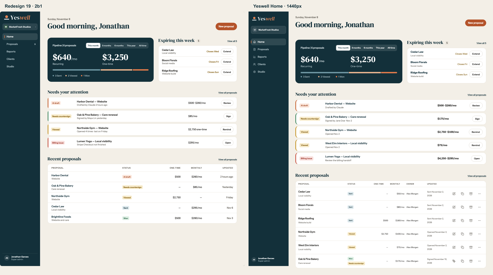
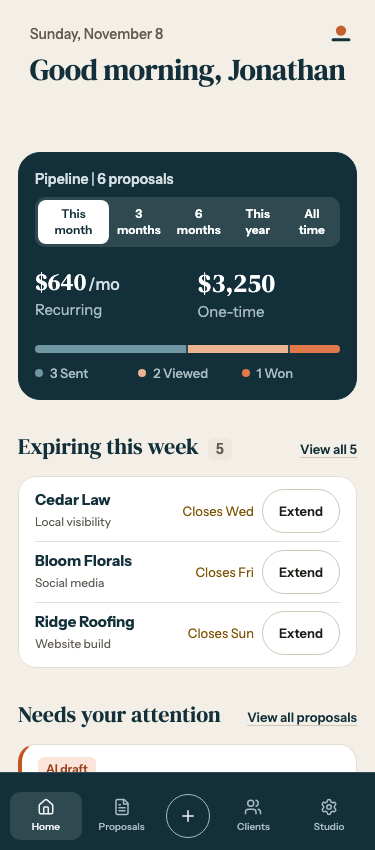
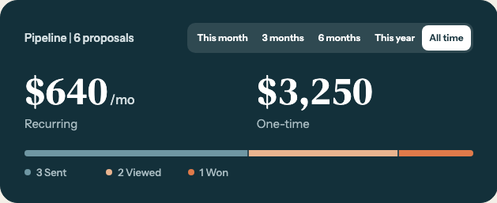
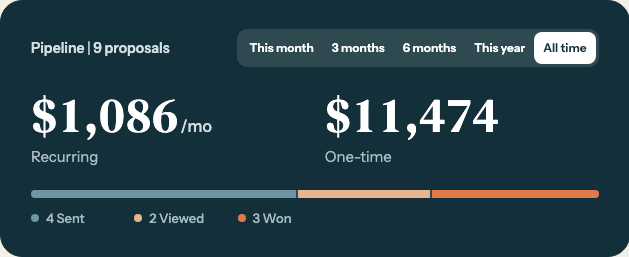
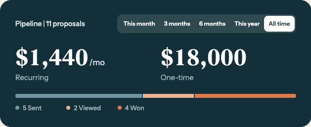

# Home · Redesign 19 frame 2b1

## Desktop

[Full-width 1440px capture](home-1440.png)

## Phone

[Full phone page](home-375-full.png)

## Range transition

The All time selection changes the totals from 6 proposals, $640/mo and $3,250 one-time to 11 proposals, $1,440/mo and $18,000 one-time. The three frames use Chromium's controlled clock.

| 0 ms | 120 ms | 600 ms |
| --- | --- | --- |
|  |  |  |
