# QuickBooks customer review and connection details

All application screenshots use synthetic sandbox fixtures. Stripe uses test-mode fixtures.

## Connection detail pages

The provider mark and rectangular chip follow Redesign 19 **2e8**. The title, hairlines and label/value layout follow **2e12**.

| R19 2e8: Connections | R19 2e12: Billing defaults |
| --- | --- |
| 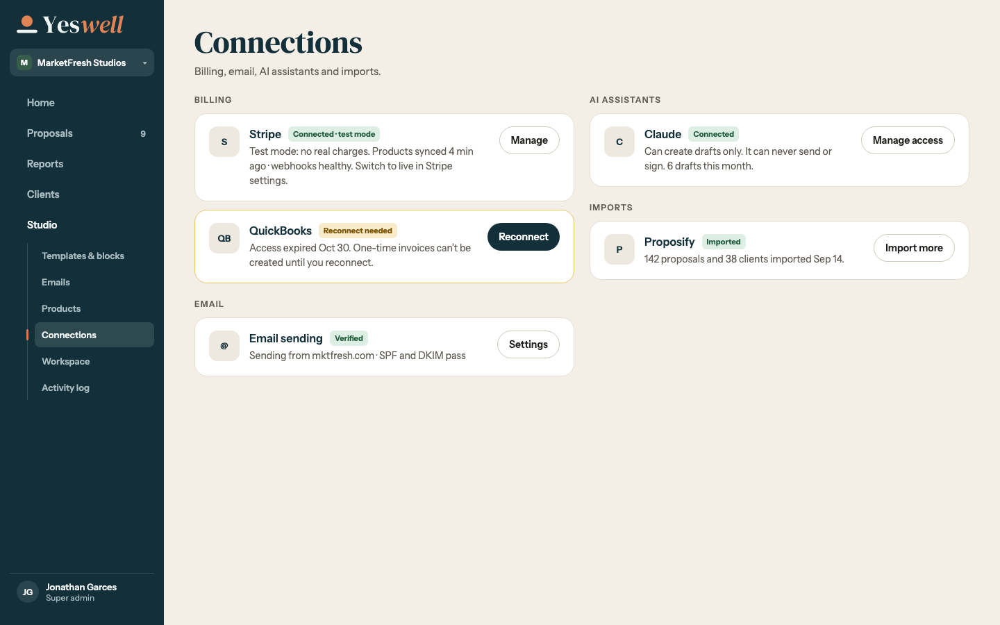 | 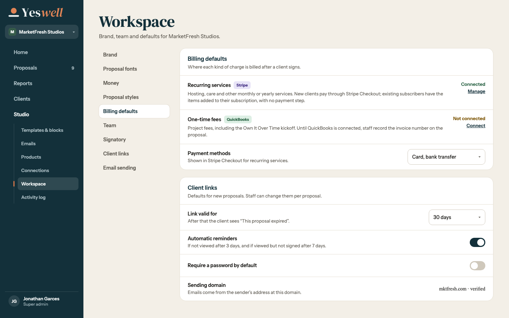 |

| State | 1440 | 375 |
| --- | --- | --- |
| QuickBooks: connected | 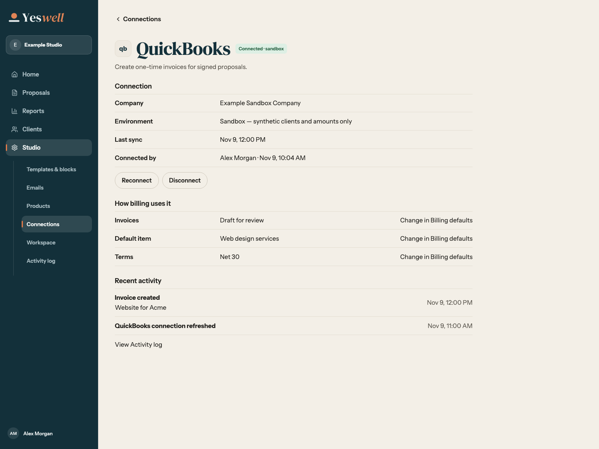 | 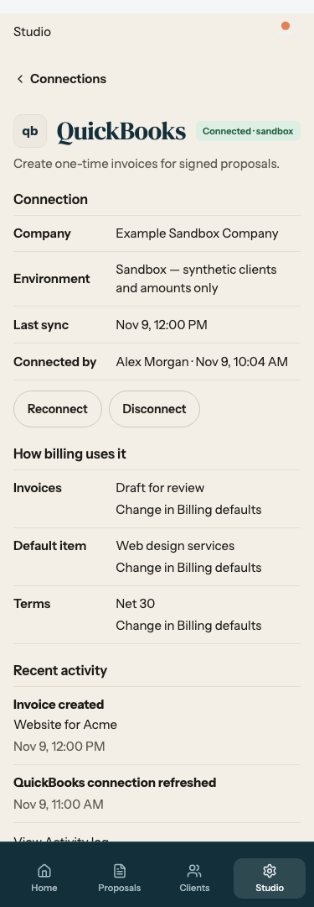 |
| QuickBooks: not connected | 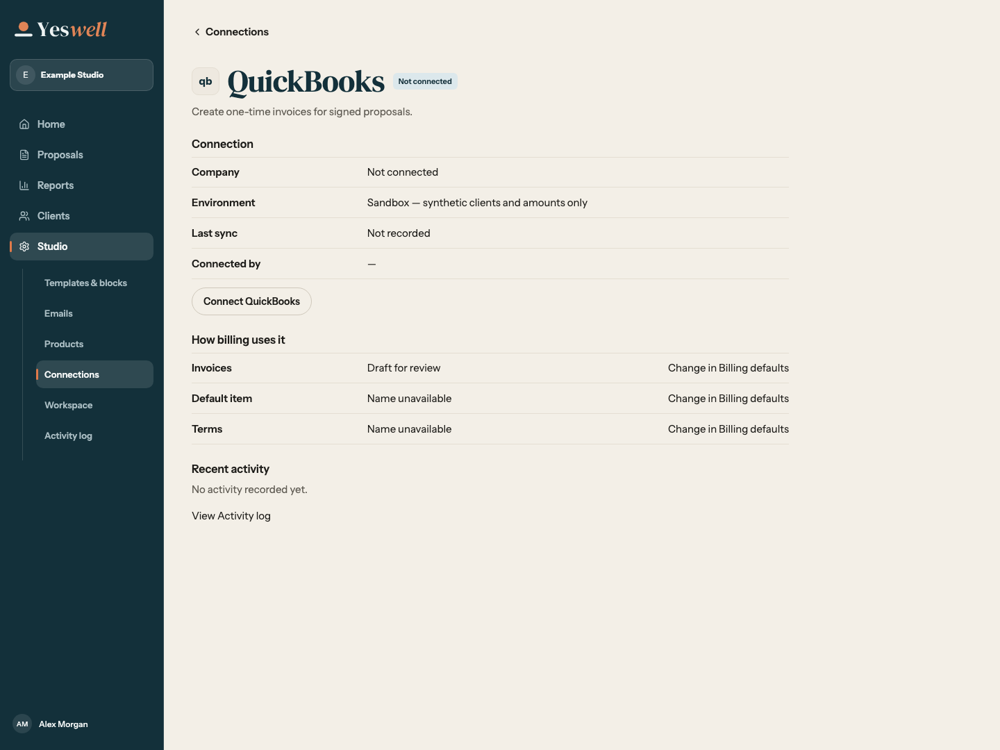 | 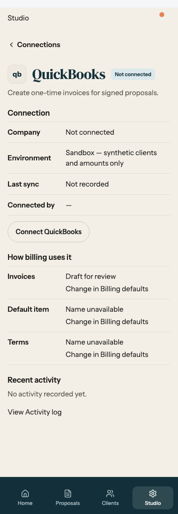 |
| QuickBooks: reconnect needed | 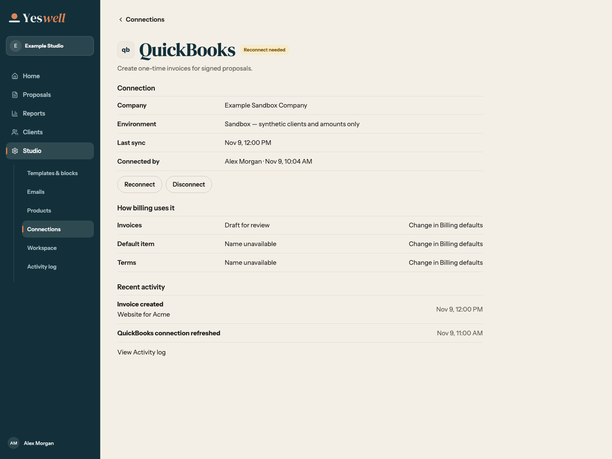 | 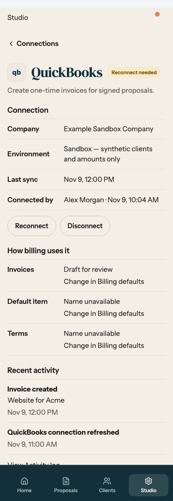 |
| Stripe: connected in test mode | 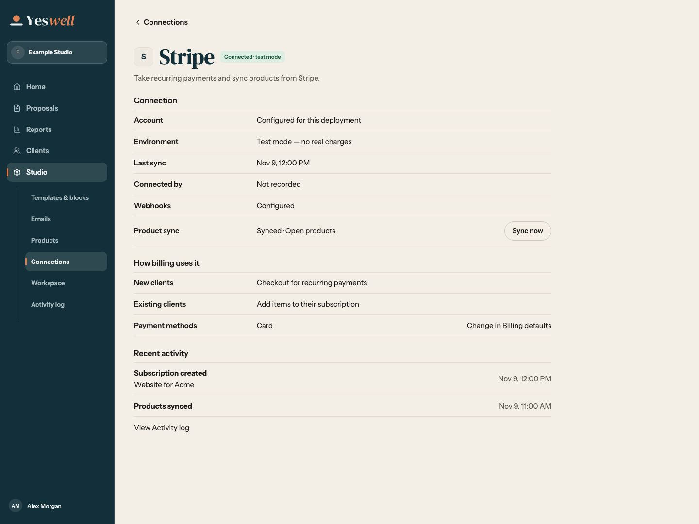 | 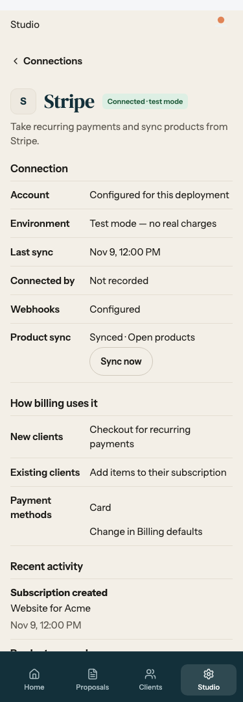 |
| Stripe: not connected | 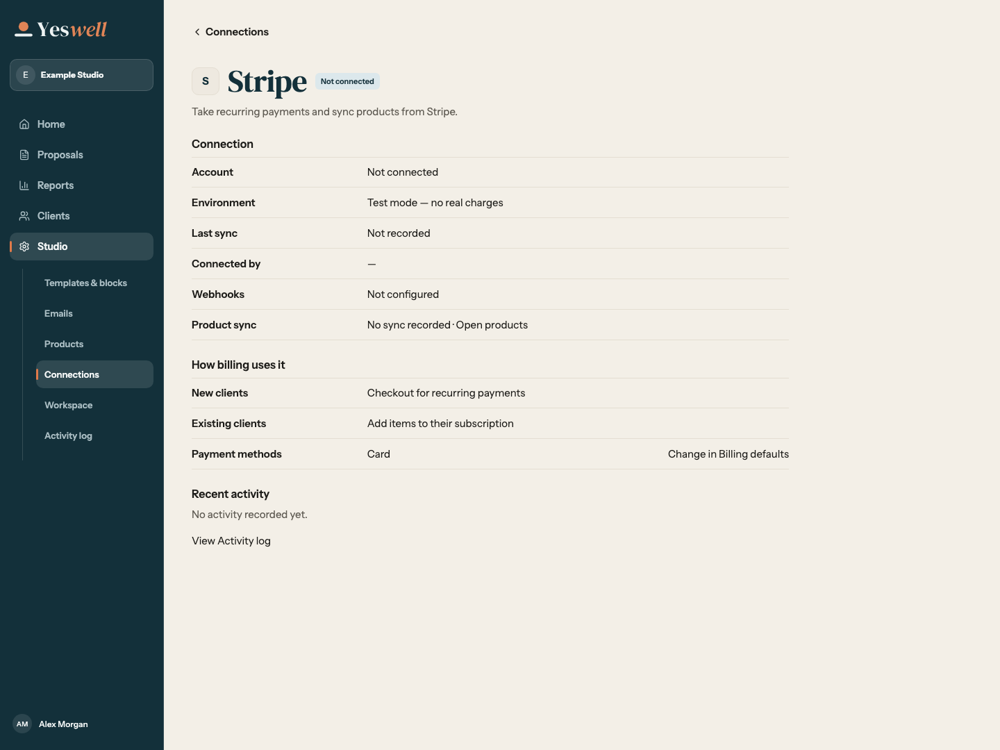 | 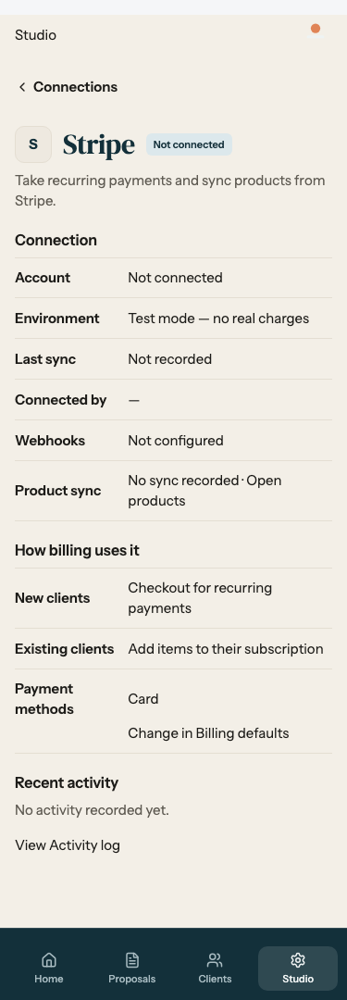 |

[Disconnect confirmation](quickbooks-disconnect-confirm-1440.png) uses the shared destructive dialog, with Cancel first.

[Email sending](connection-email-1440.png), [AI assistants](connection-assistants-1440.png), and [Proposify imports](connection-imports-1440.png) use the same 2e8/2e12 connection-detail pattern.

## Item mapping

[Billing defaults](billing-defaults-1440.png) and the [searchable default item](billing-default-item-1440.png) use the setting rows from **2e12**. The [per-product picker](product-item-picker-1440.png) follows the product details from **2e7** and uses the same combobox.

## Proposal Billing

The [customer chooser](customer-chooser-1440.png), [draft invoice](record-draft-invoice-1440.png), and [billing failure with one retry](record-retry-1440.png) use the record sheet from **2c8**. Customer choices use one frame with separated rows and a marker for the selected row (Redesign 19 rule 7).
