# Redesign 22 · Your account

| R22 frame | Reference | Implementation |
| --- | --- | --- |
| 1a · Profile, 1440 |  | 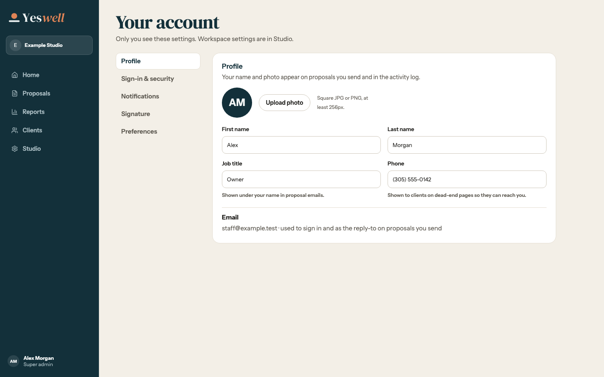 |
| 1b · Notifications, 1440 | 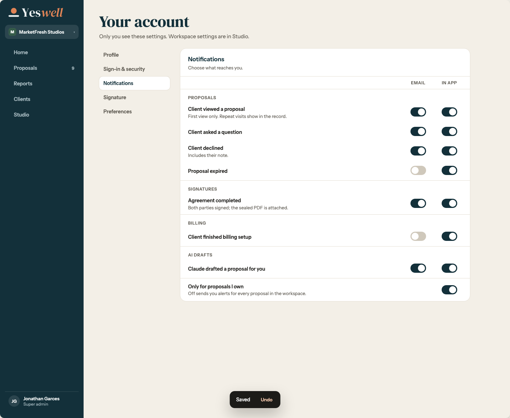 | 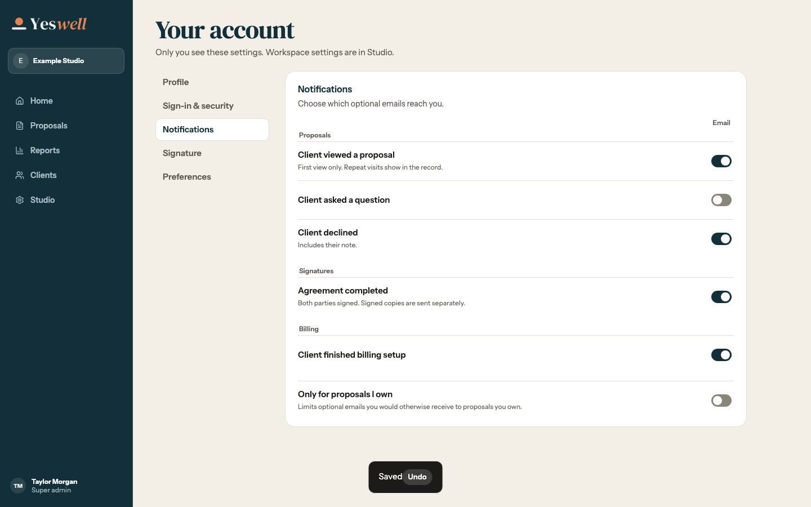 |
| 1b3 · Company signatory, 1440 | 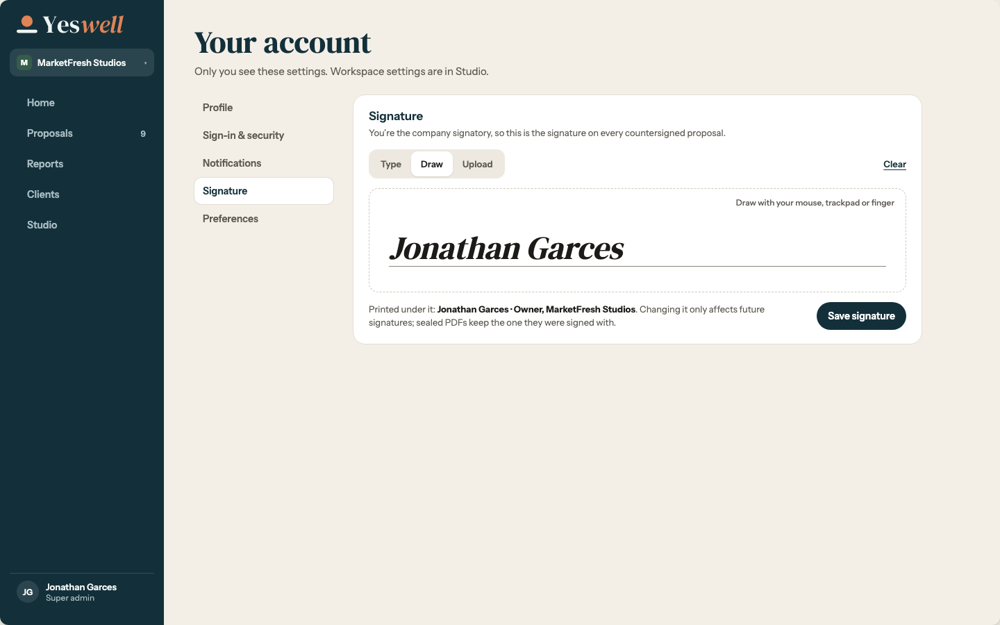 | 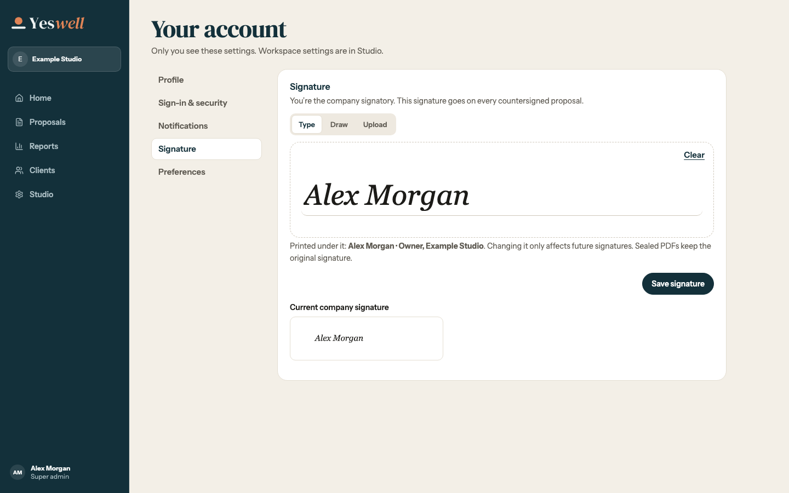 |
| 1b2 · Staff signature, 1440 | 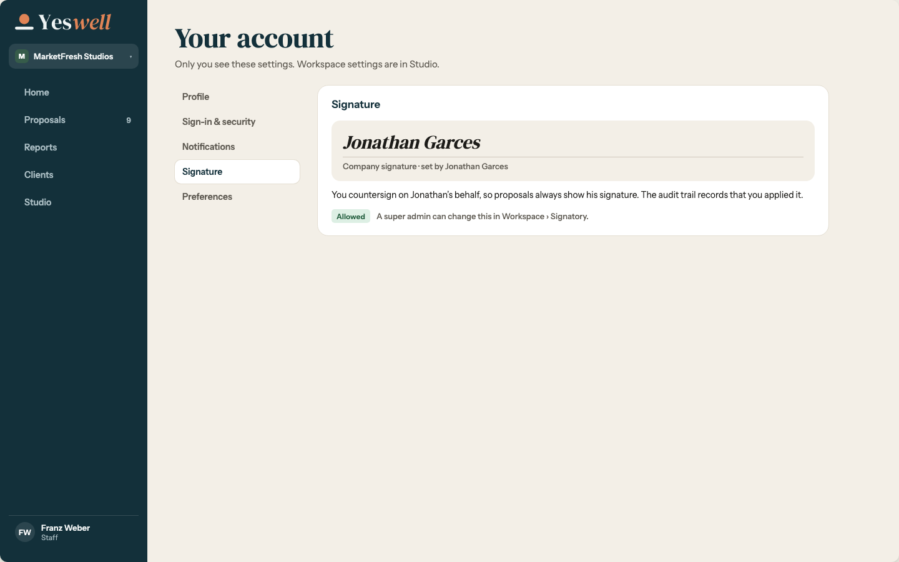 | 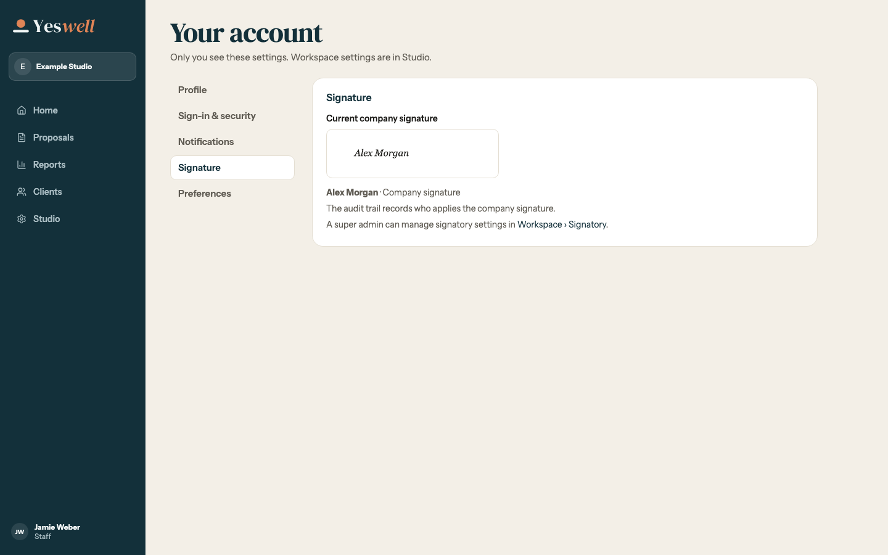 |
| 1b4 · Preferences, 1440 | 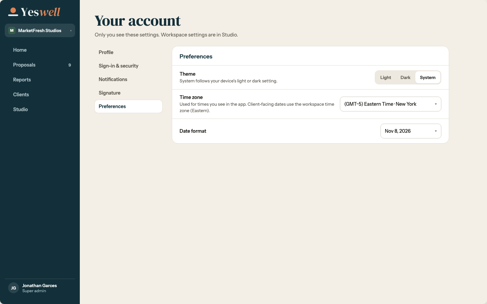 | 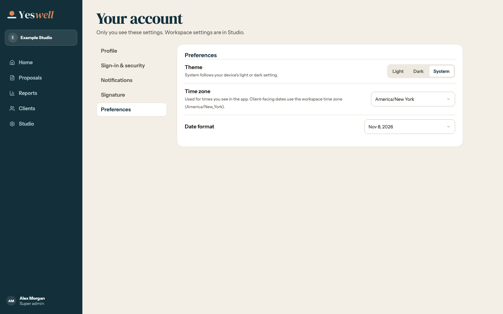 |
| 1c · Account menu, 1440 | 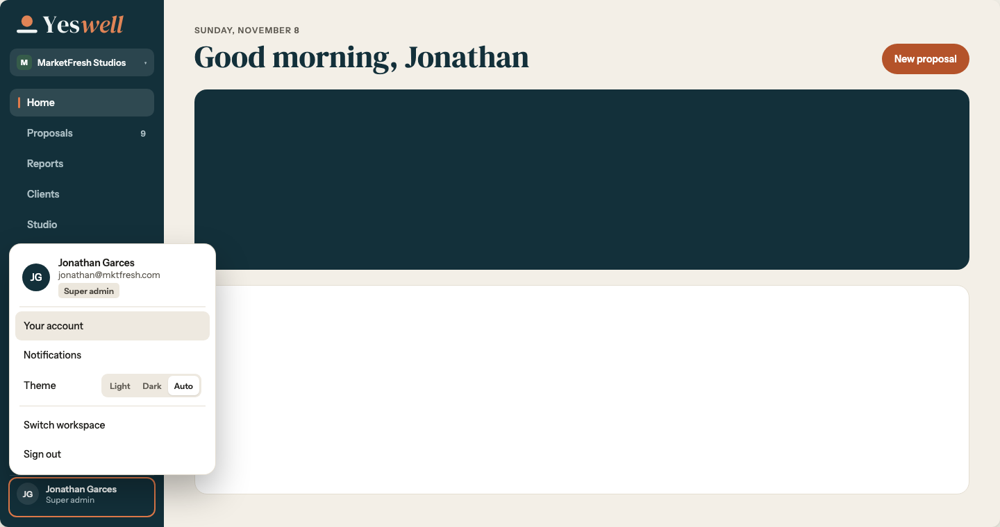 | 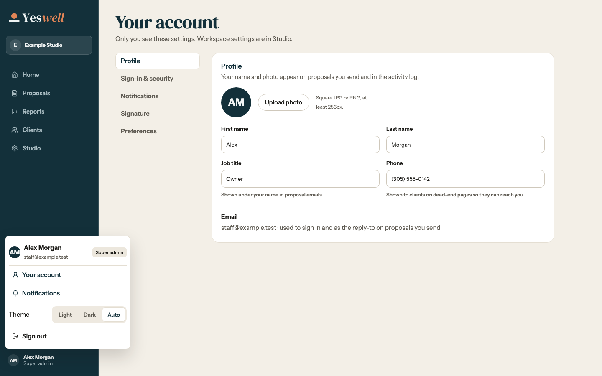 |
| 1f · Notifications, 768 | 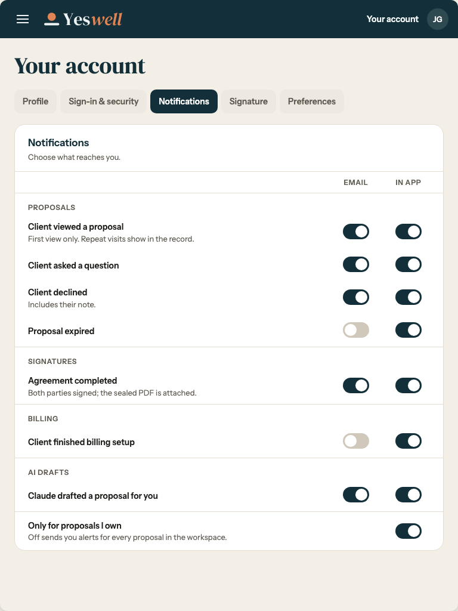 | 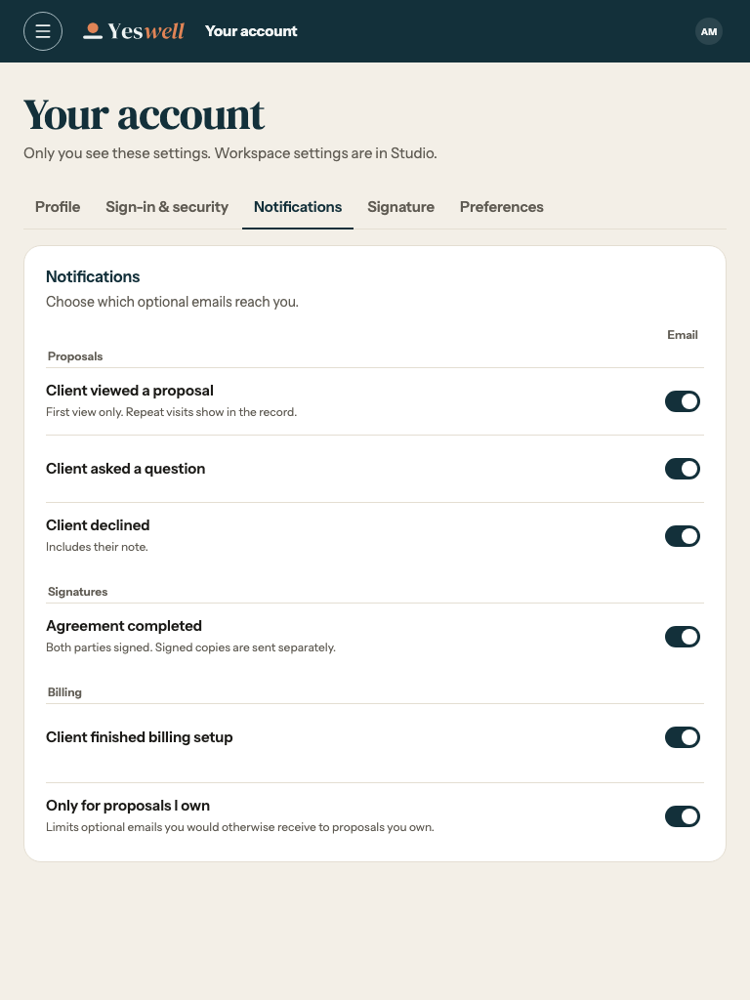 |
| 1g · Account index, 375 | 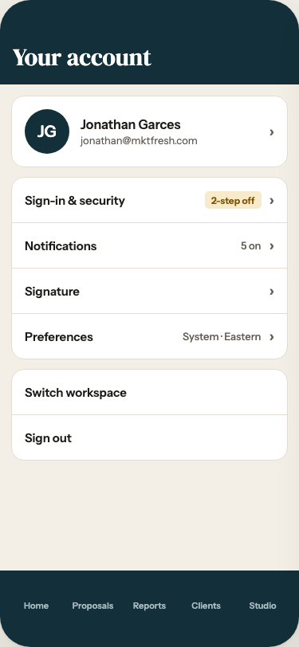 | 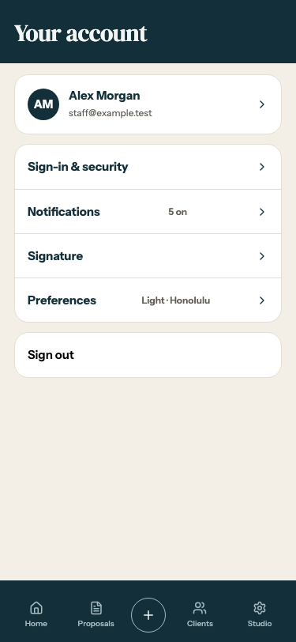 |
| 1g · Notifications, 375 | 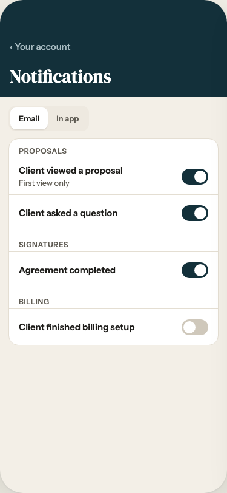 | 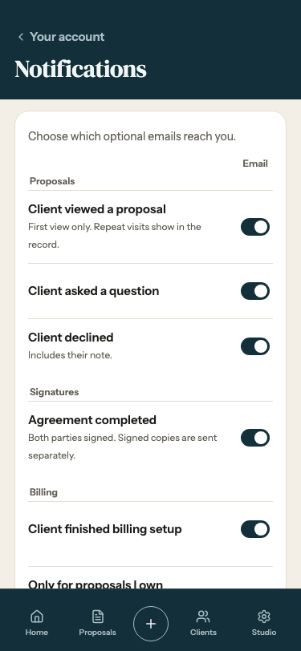 |
| 1g · Signature, 375 | 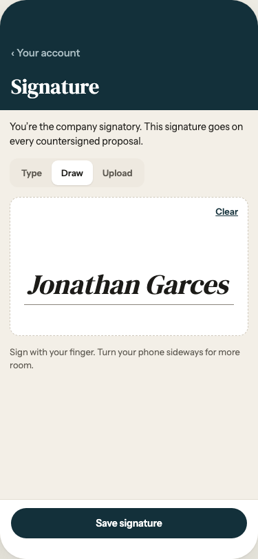 | 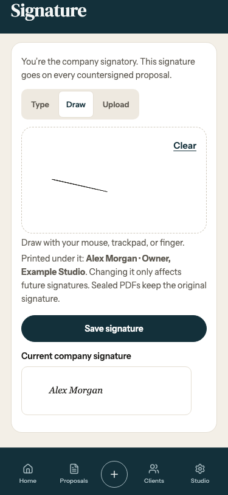 |

The reference is [Redesign 22](../../../design/ink-and-clay/Redesign%2022%20-%20Account.dc.html). The account menu omits Switch workspace, the Notifications page shows existing optional email only, and Profile keeps email read-only. The account uses the app’s shared phone navigation.
