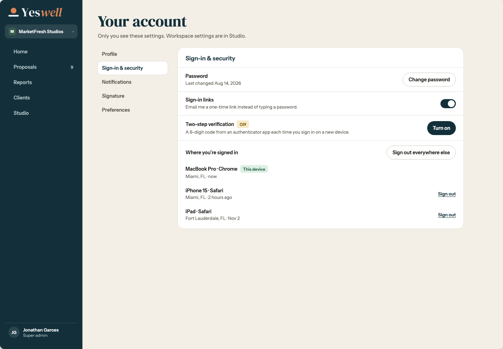
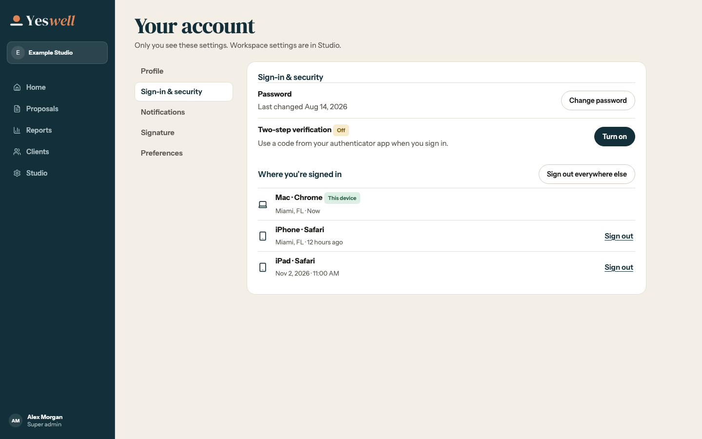
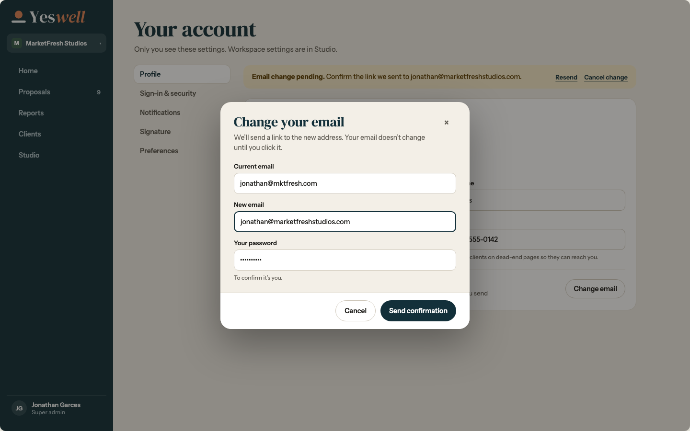
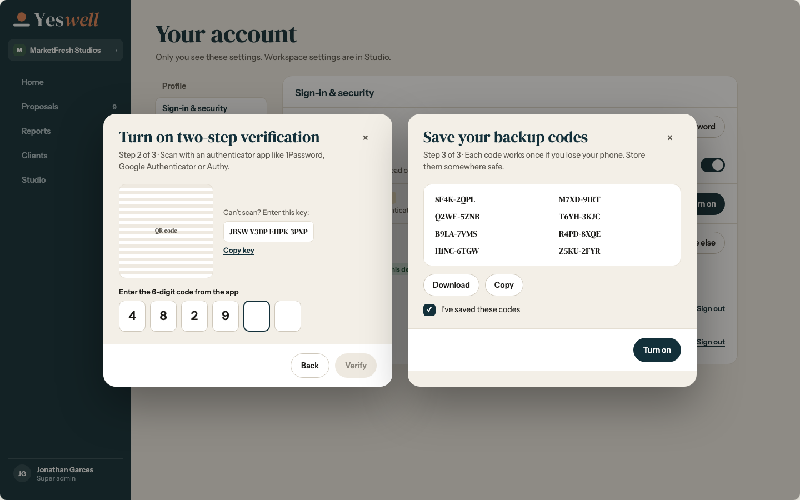
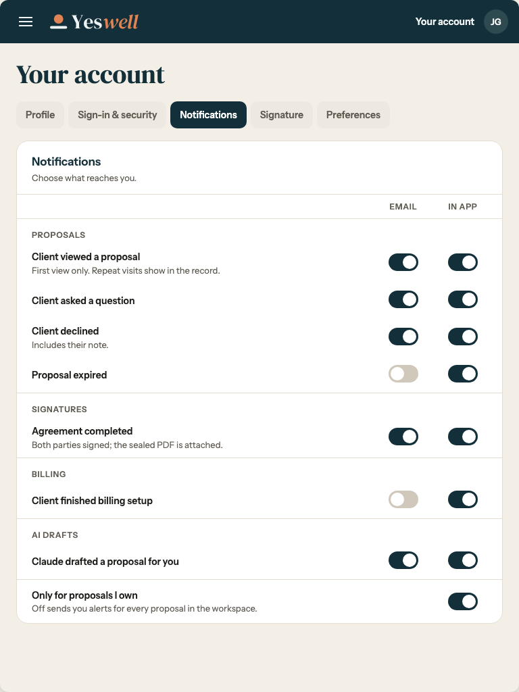
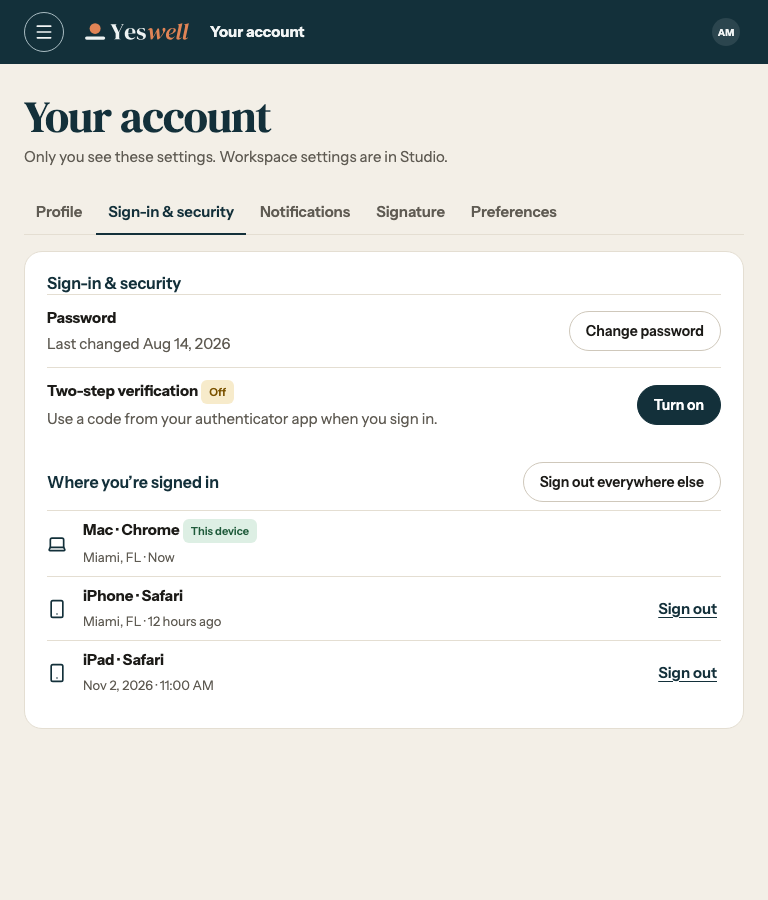
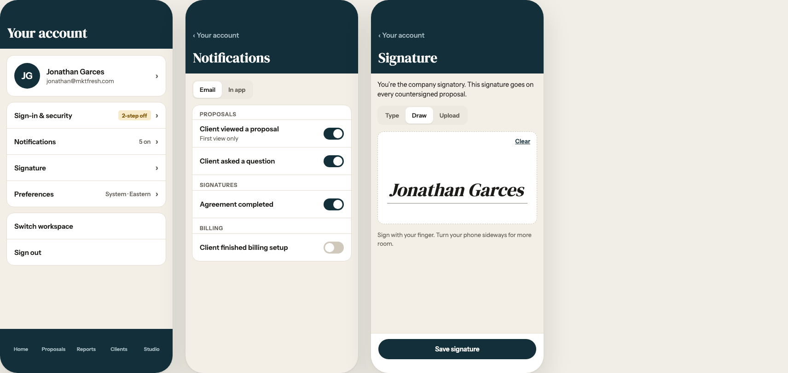
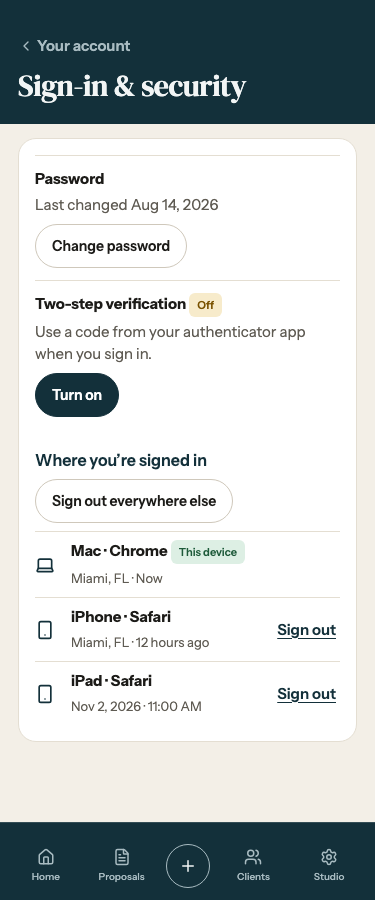
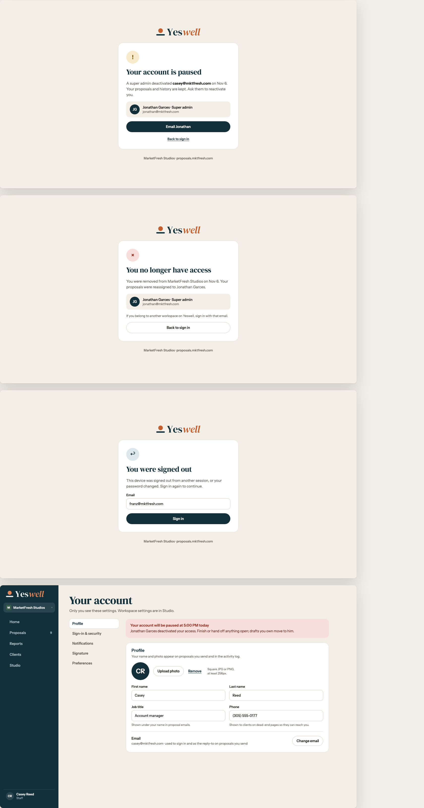

# Redesign 22 · Sign-in & security

| R22 frame | Reference | Implementation |
| --- | --- | --- |
| 1a2 · Sign-in & security, 1440 |  |  · [Change password](1a2-change-password-1440.png) · [Sign out a device](1a2-sign-out-device-1440.png) |
| 1d · Change email, 1440 |  | [Change email dialog](1d-change-email-1440.png) · [Pending notice](1d-pending-1440.png) |
| 1d2 · Email confirmation, 1440 |  | [Check your new inbox](1d2-inbox-1440.png) · [Email changed](1d2-confirmed-1440.png) |
| 1e · Two-step setup, 1440 |  | [Scan authenticator QR](1e-authenticator-1440.png) · [Save backup codes](1e-backup-codes-1440.png) |
| 1f · Account section tabs, 768 |  |  |
| 1g · Account subpage, 375 |  |  |
| 1h · Account access states, 1440 |  | [Paused](1h-paused-1440.png) · [Removed](1h-removed-1440.png) · [Signed out](1h-signed-out-1440.png) · [Verify sign-in](1h-two-step-1440.png) |

The captures use test accounts, devices, and credentials. The public confirmation and authenticator challenge use the same centered frame as 1h. R22 frame 1a2 supplies the layout for the password and session dialogs.

[Redesign 22 source](../../../design/ink-and-clay/Redesign%2022%20-%20Account.dc.html)
