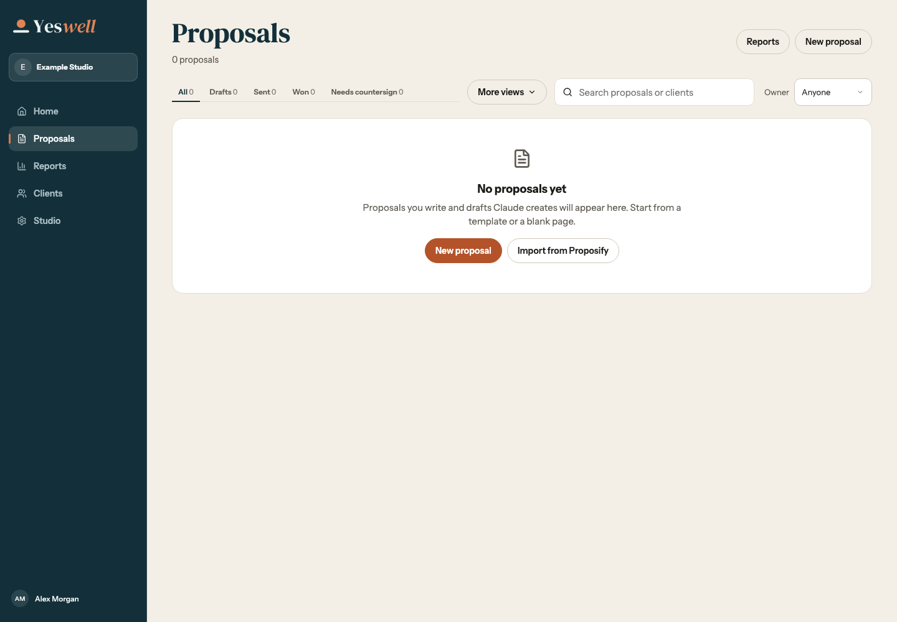
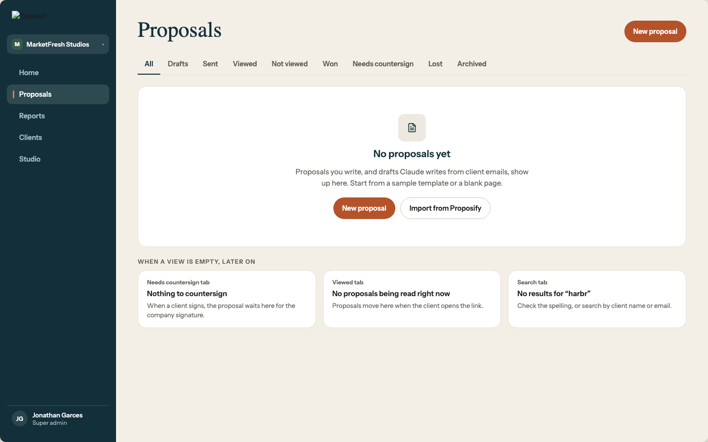
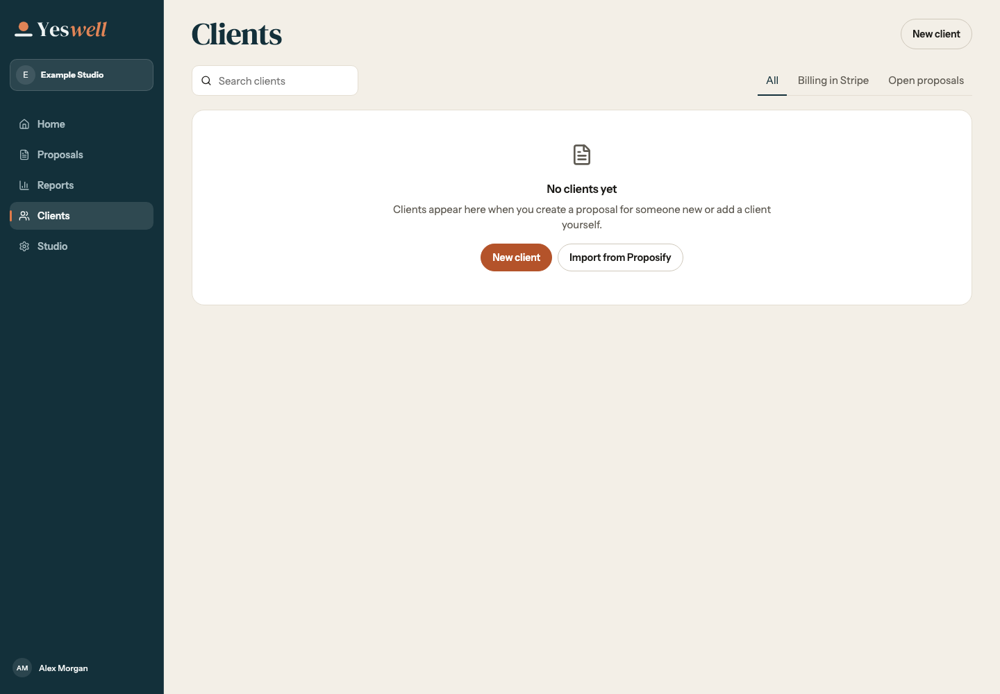
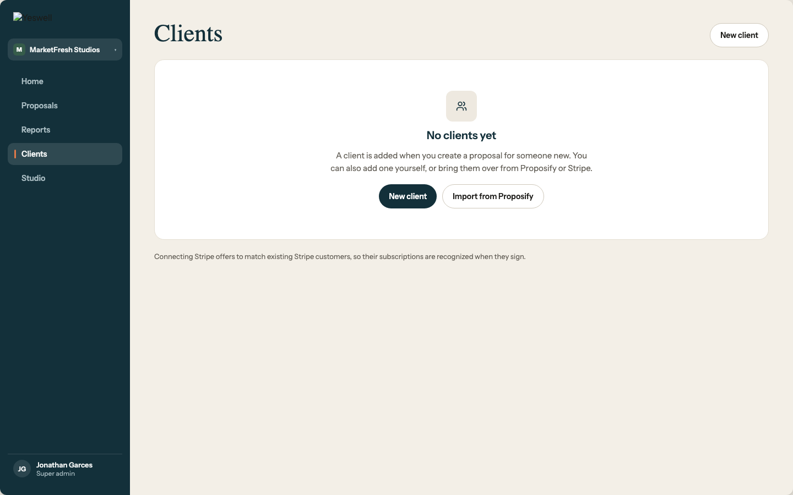
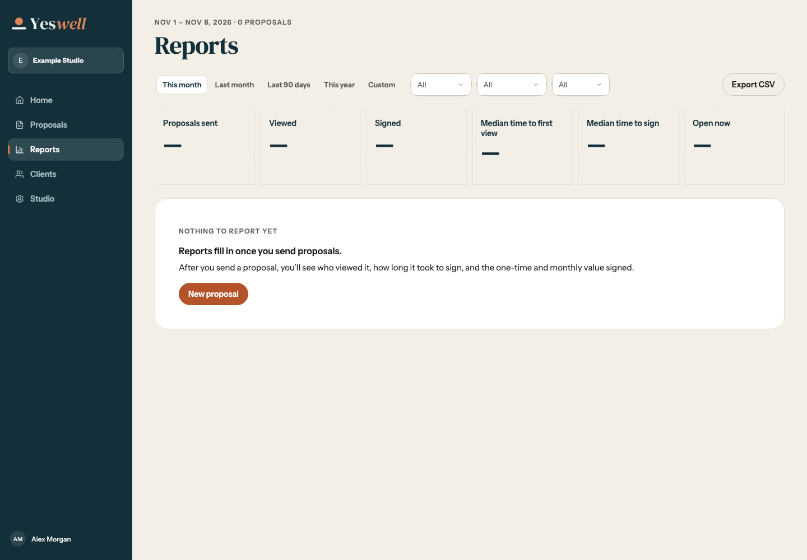
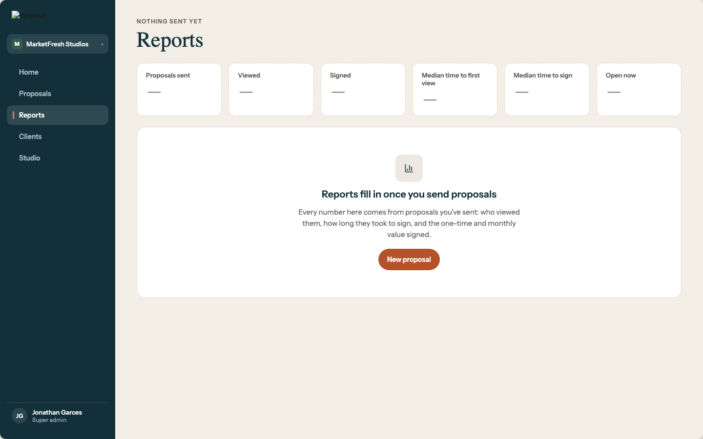
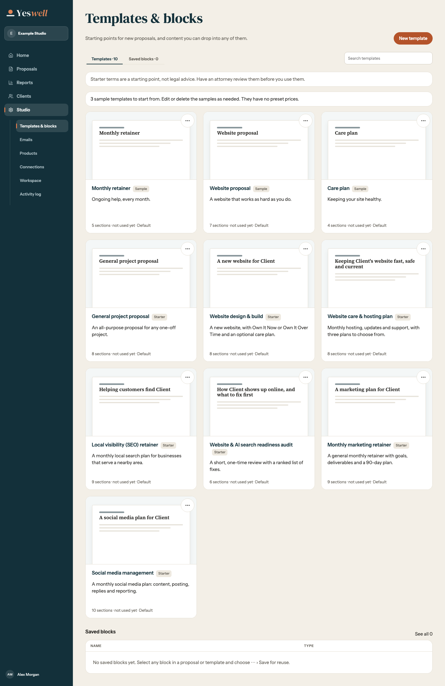
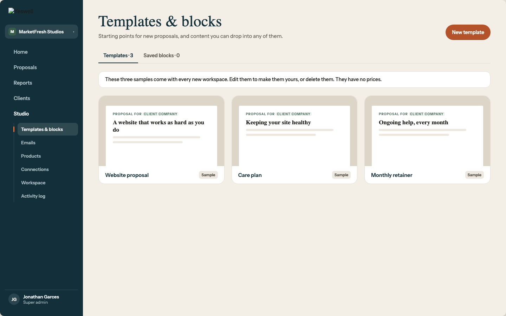
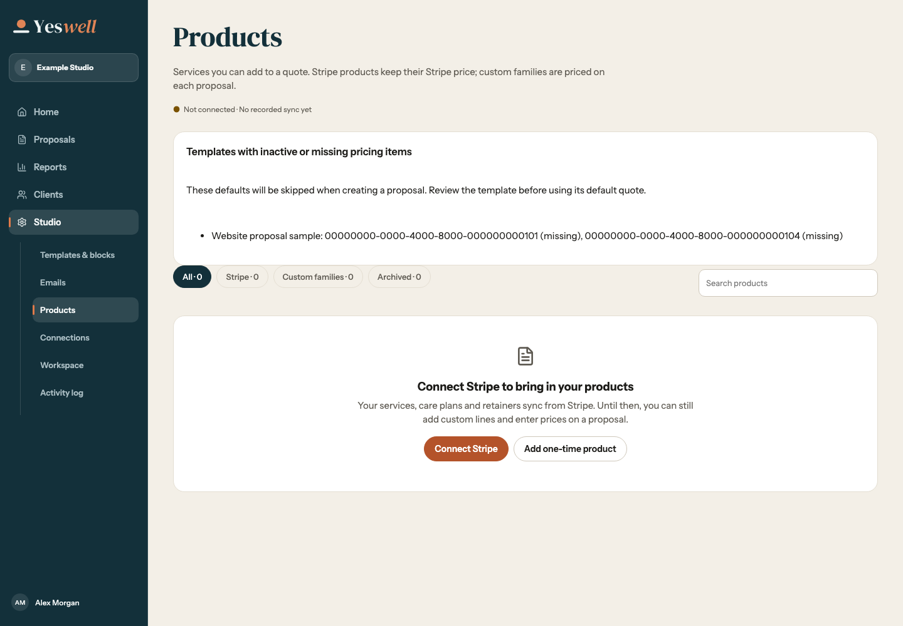
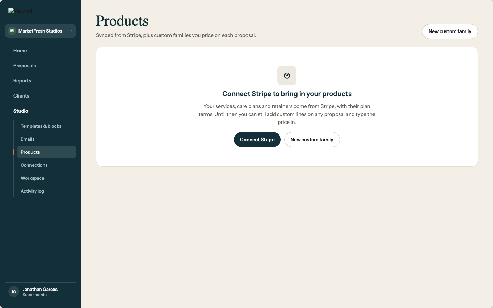

# Redesign 21 B review

These captures use synthetic workspace data. Home retains the existing Redesign 19 arrangement, per the owner's follow-up. Redesign 21 supplies the setup and empty-state patterns, not a new Home layout.

| Home state | 1440 | 375 | Redesign 21 |
| --- | --- | --- | --- |
| Day one | [Desktop](home-day-one-1440.png) | [Phone](home-day-one-375.png) | [1a](reference-1a.png), [1i](reference-1i.png) |
| Partly done | [Desktop](home-partly-done-1440.png) | [Phone](home-partly-done-375.png) | [1b](reference-1b.png) |
| Set up | [Desktop](home-set-up-1440.png) | [Phone](home-set-up-375.png) | [2b](reference-2b.png) |
| Staff welcome banner | [Desktop](home-staff-1440.png) | [Phone](home-staff-375.png) | [1c](reference-1c.png) |

| Empty state | App at 1440 | Redesign 21 |
| --- | --- | --- |
| Proposals |  |  |
| Clients |  |  |
| Reports |  |  |
| Sample templates |  |  |
| Products before Stripe |  |  |
