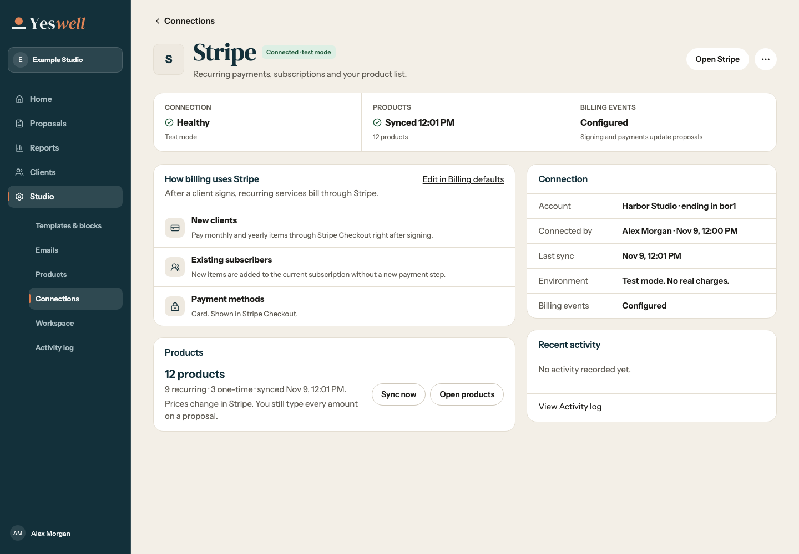
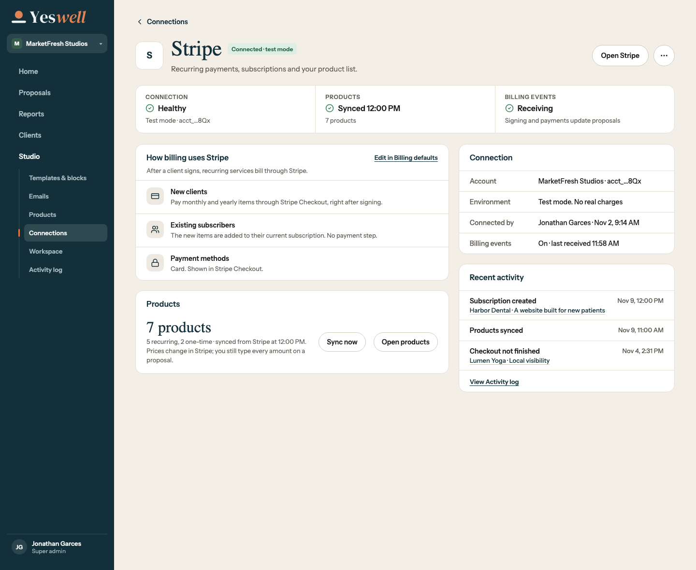
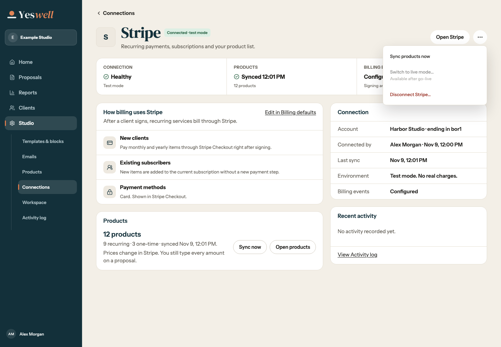
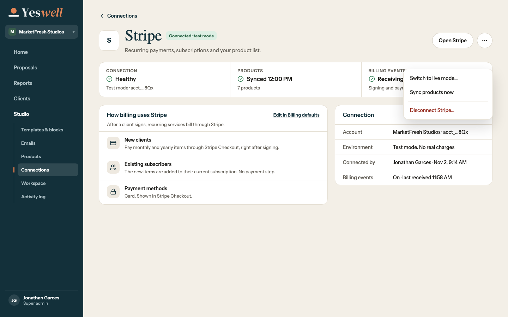
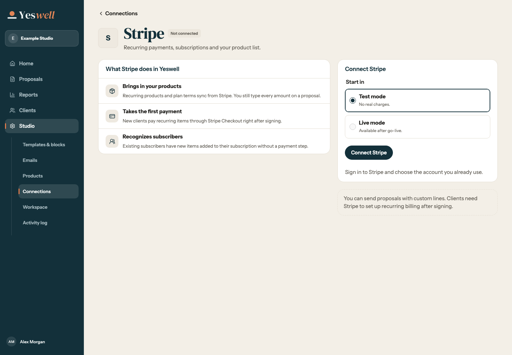
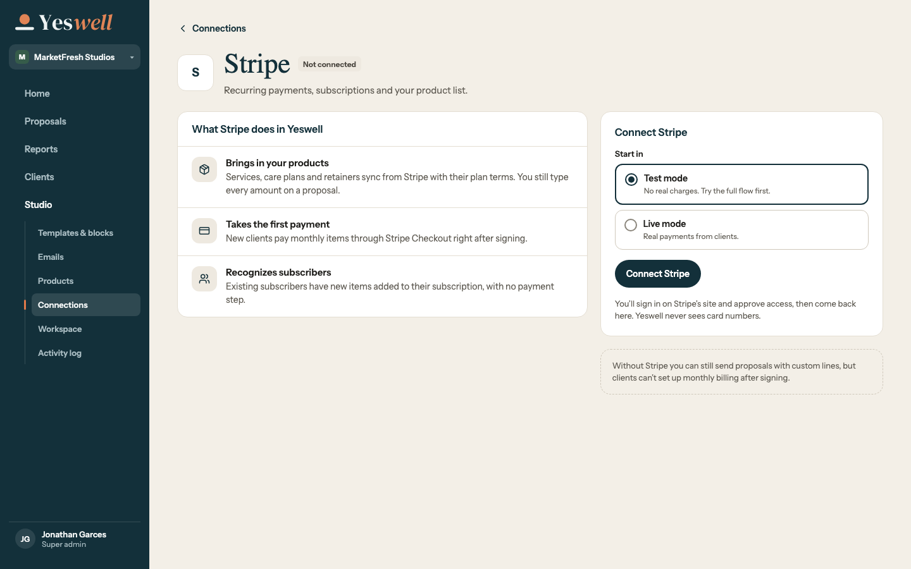
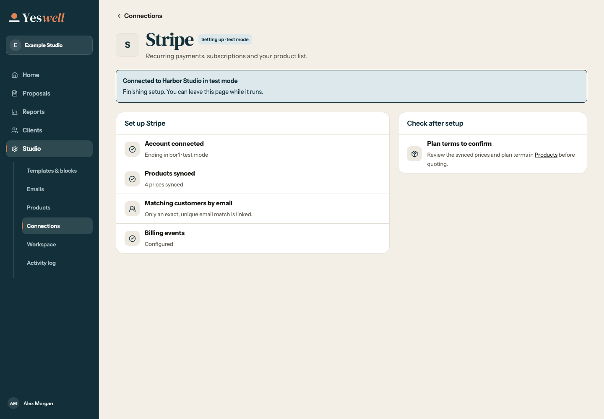
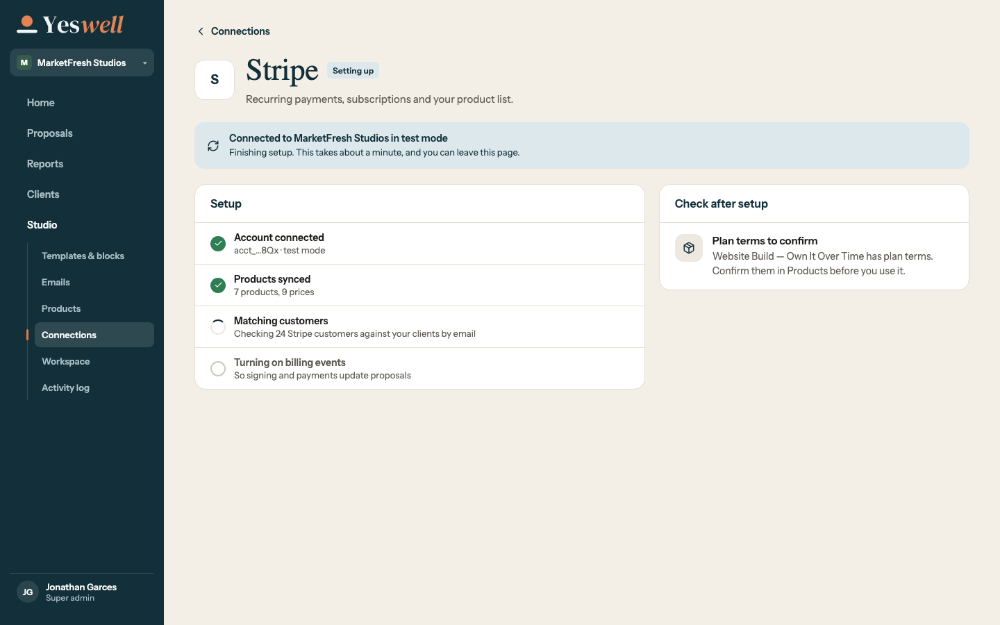
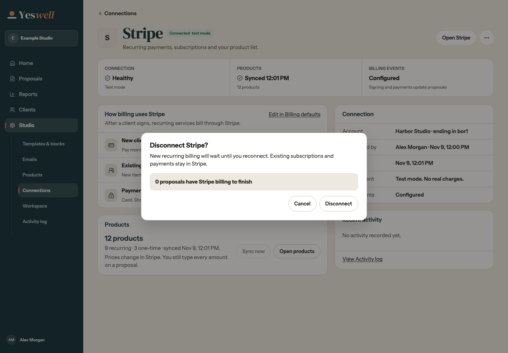
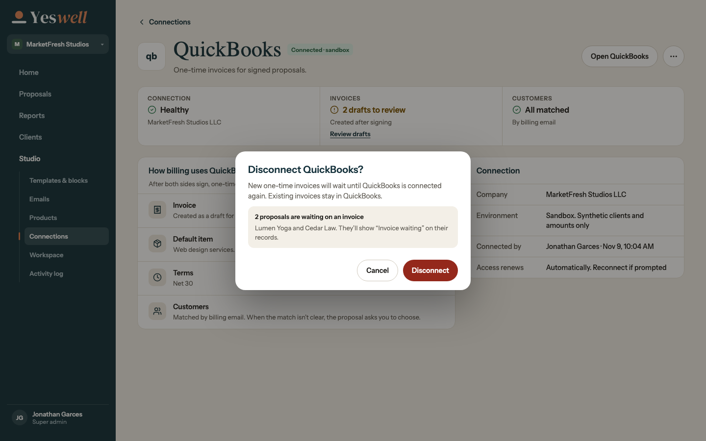

# Redesign 21 Stripe Connect

Screenshots use synthetic workspaces and Stripe test fixtures. Desktop captures are 1440px wide. Phone captures are 375px wide.

| Screen | Implementation | Reference |
| --- | --- | --- |
| Connected test account |  |  |
| Account actions |  |  |
| Start in test mode |  |  |
| Setup progress |  |  |
| Disconnect impact and confirmation |  |  |

[Phone setup](connect-375.png) uses the R21 3c sections in the responsive detail shell. The [phone actions menu](actions-375.png) uses the R21 3k bottom sheet.
