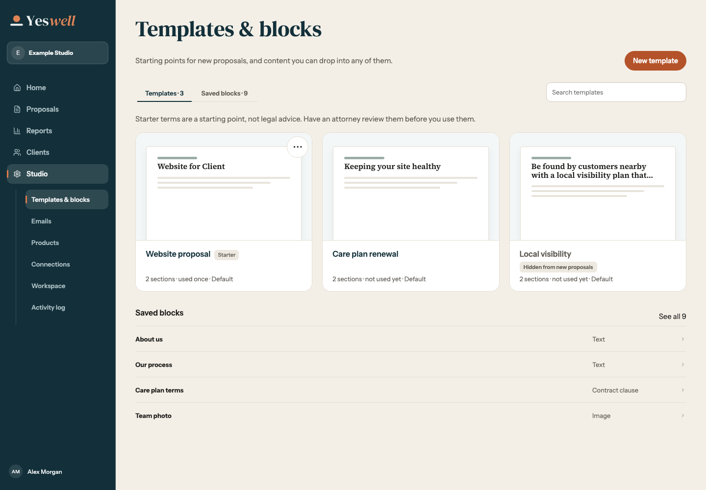
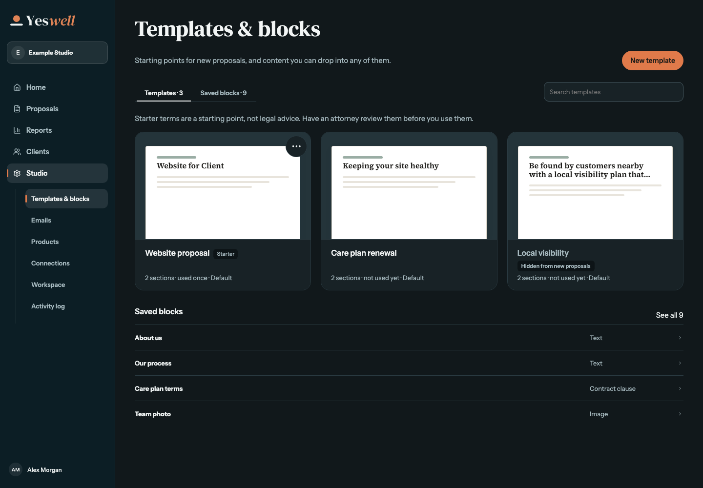
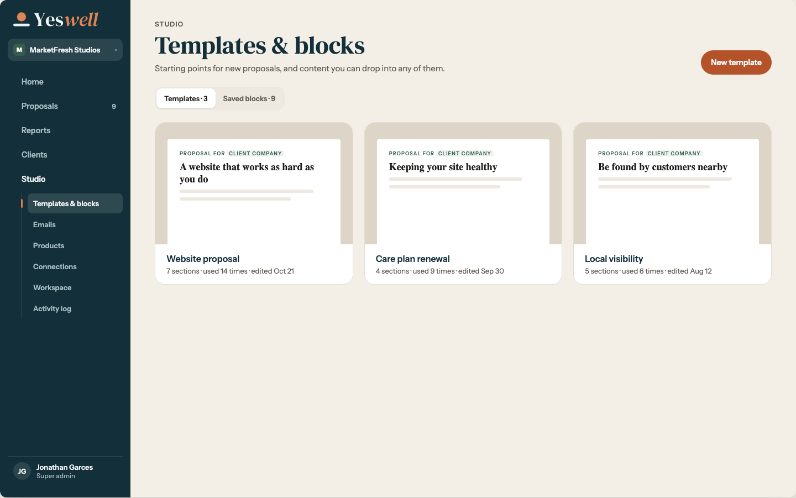

# Reports and provider branding

All app screenshots use synthetic data. The reference captures are from the checked-in Redesign 19 and Redesign 16 artboards.

| Report state | App | Reference |
| --- | --- | --- |
| Populated, 1440px |  |  |
| Empty, 1440px |  |  |

The owner requested one combined Value signed and Pipeline card. The reference shows two neighboring cards. The app uses its existing white empty card and the requested report typography. The populated fixture shows CAD and USD separately, including a yearly value.

- Reports at [1024px](reports-1024.png), [768px](reports-768.png), and [1440px in dark mode](reports-dark-1440.png).
- Reports at 375px with [summary](reports-375.png), [values and pipeline](reports-stages-375.png), [breakdowns](reports-breakdowns-375.png), and [engagement](reports-engagement-375.png).

## Provider branding at 1440px

| View | Light | Dark |
| --- | --- | --- |
| Connections cards |  |  |
| Stripe detail |  |  |
| QuickBooks, connected |  |  |
| Connect to QuickBooks |  |  |

The [Home checklist](setup-checklist-1440.png) uses the same original marks.

## Template cards at 1440px

| Light | Dark | Geometry reference |
| --- | --- | --- |
|  |  |  |

The owner's updated values take precedence over the older preview fill in the checked-in frame.

| Part | Updated spec |
| --- | --- |
| Card | 18px corners, staff surface, 1px staff border, clipped overflow |
| Preview | 220px height, #F4F7F7 in light, #24343A in dark, 22px top and side padding, bottom-aligned sheet, 1px bottom divider |
| Sheet | White, 3px top corners, 20px × 22px padding, #E4DED2 hairline and 0 6px 16px shadow at 8% ink |
| Footer | 16px × 20px padding, 16px/600 Instrument Sans name in title ink, 13px/400 muted metadata |
