# Reports and provider branding

All app screenshots use synthetic data. The reference captures are from the checked-in Redesign 19 and Redesign 16 artboards.

| Report state | App | Reference |
| --- | --- | --- |
| Populated, 1440px | 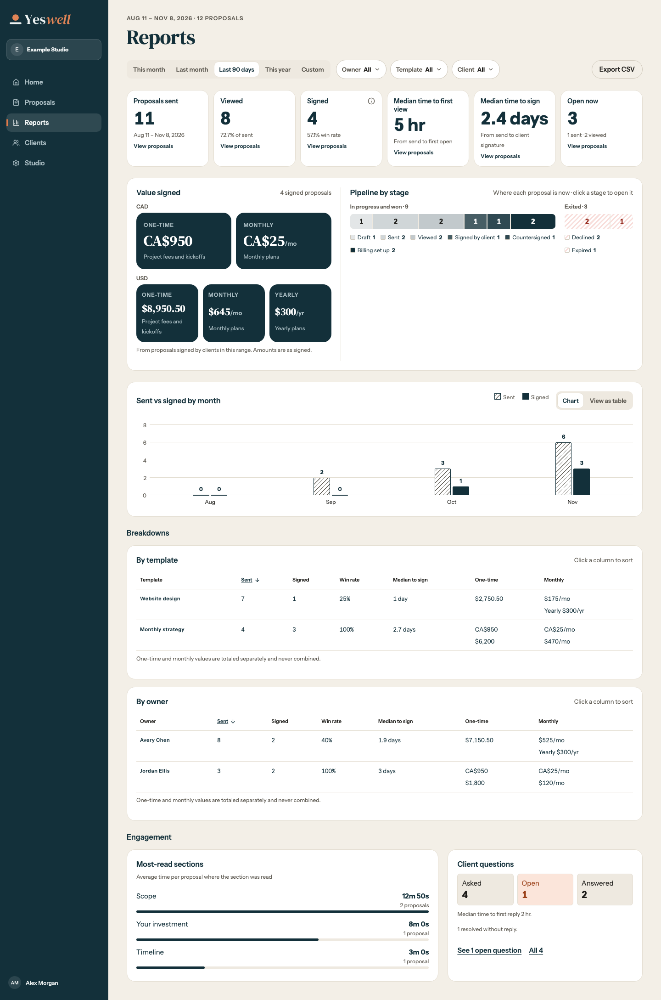 | 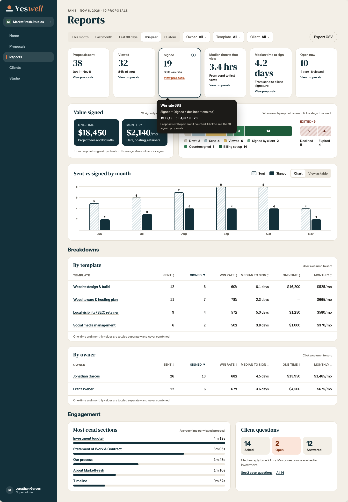 |
| Empty, 1440px | 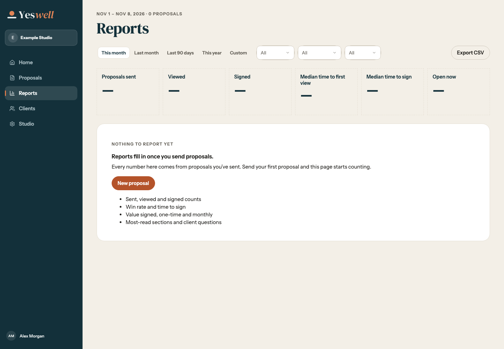 | 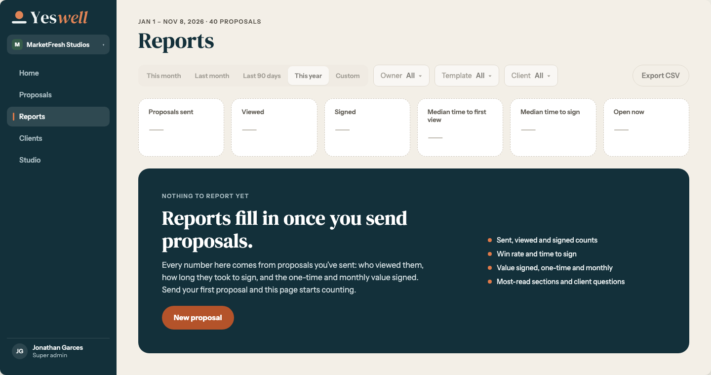 |

The owner requested one combined Value signed and Pipeline card. The reference shows two neighboring cards. The app uses its existing white empty card and the requested report typography. The populated fixture shows CAD and USD separately, including a yearly value.

- Reports at [1024px](reports-1024.png), [768px](reports-768.png), and [1440px in dark mode](reports-dark-1440.png).
- Reports at 375px with [summary](reports-375.png), [values and pipeline](reports-stages-375.png), [breakdowns](reports-breakdowns-375.png), and [engagement](reports-engagement-375.png).

## Provider branding at 1440px

| View | Light | Dark |
| --- | --- | --- |
| Connections cards | 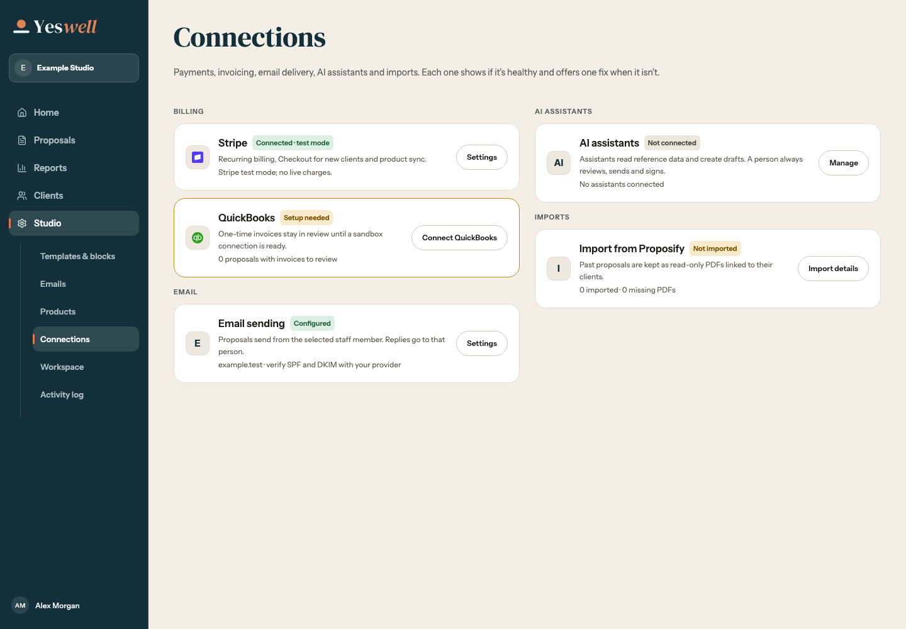 | 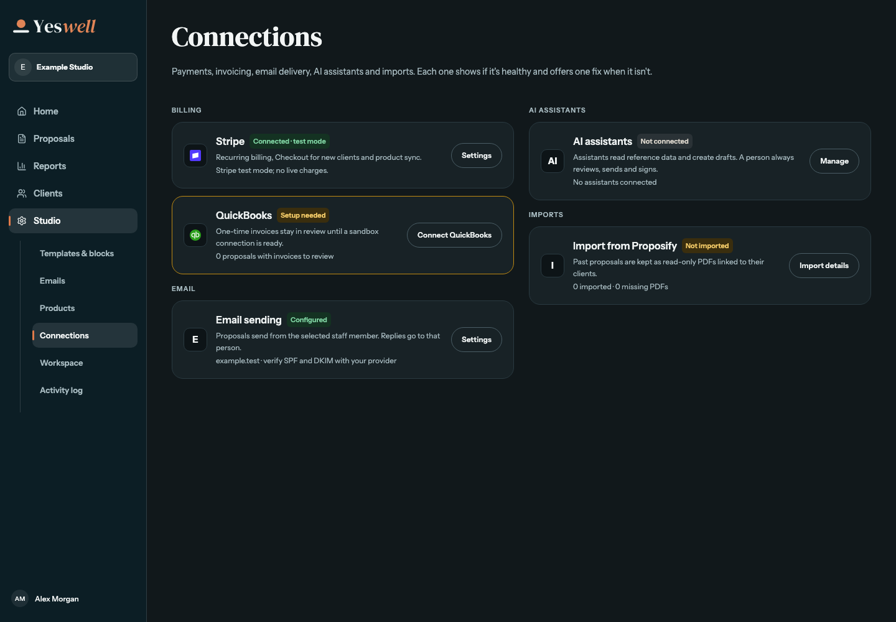 |
| Stripe detail | 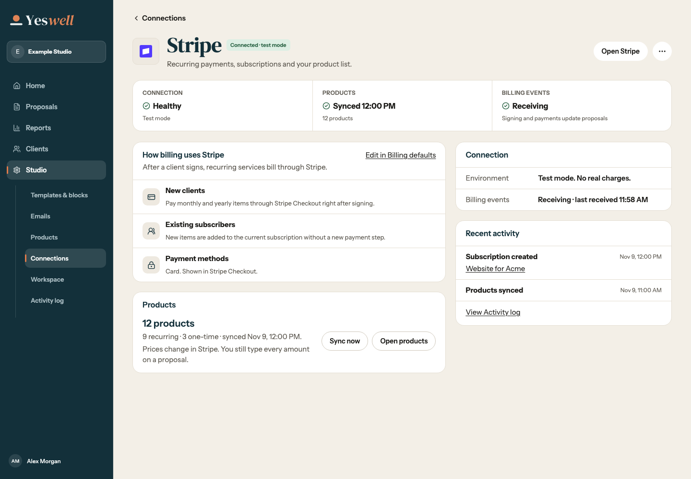 | 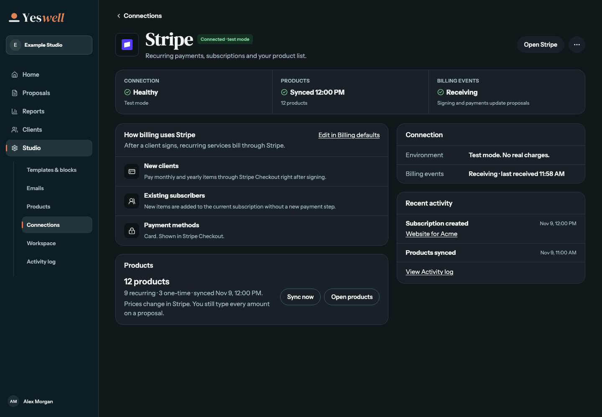 |
| QuickBooks, connected | 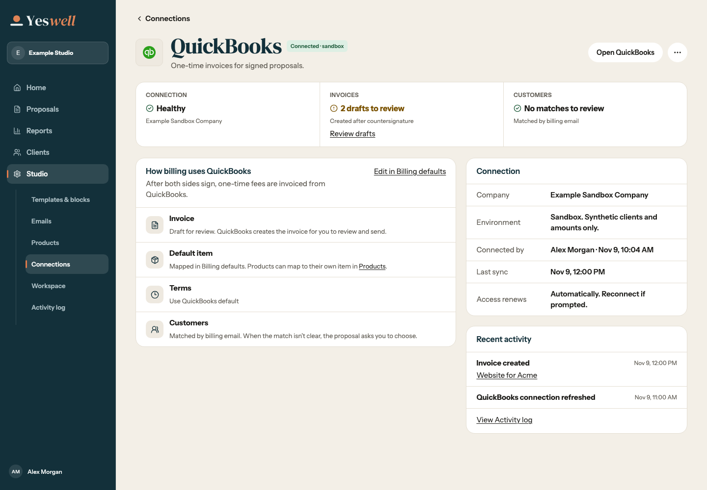 | 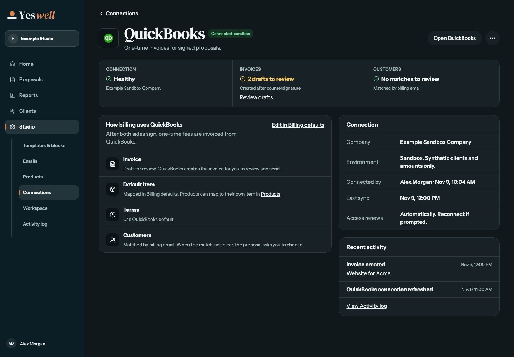 |
| Connect to QuickBooks | 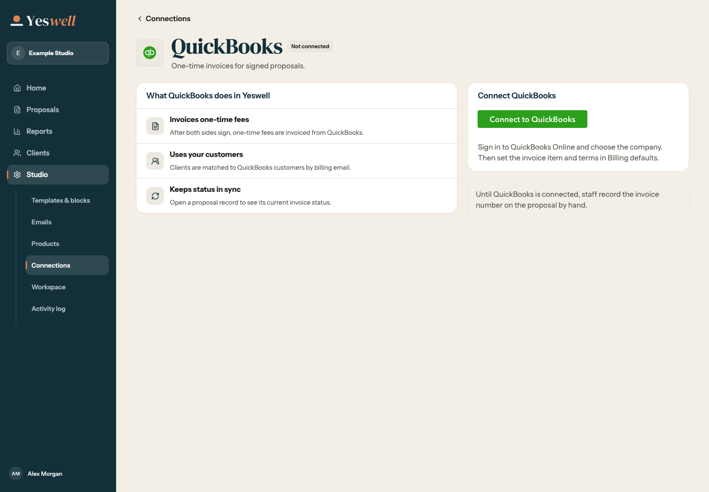 | 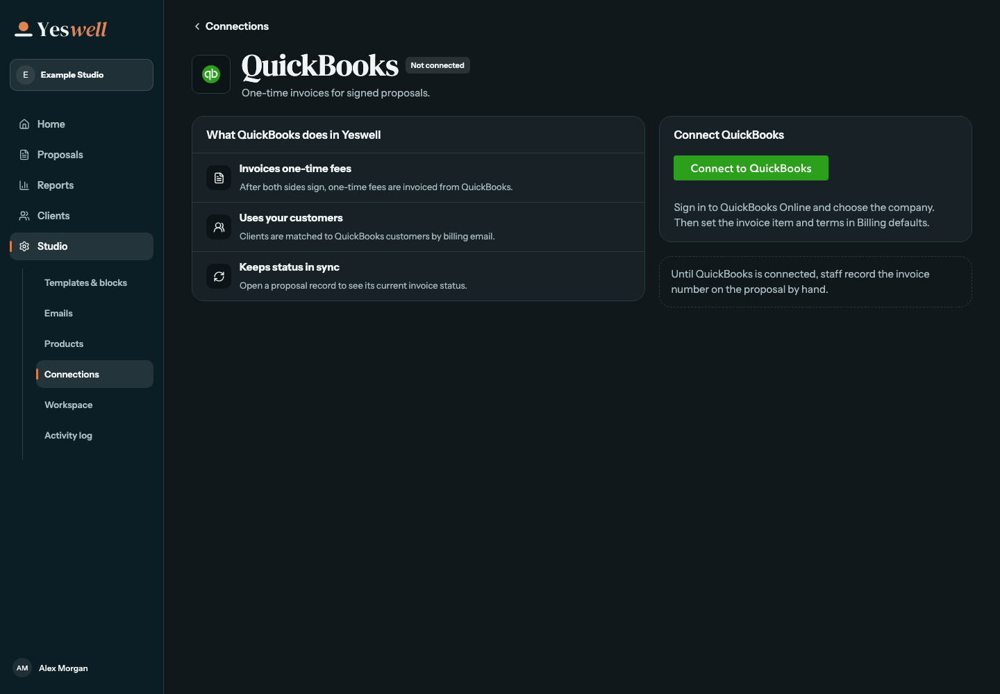 |

The [Home checklist](setup-checklist-1440.png) uses the same original marks.
