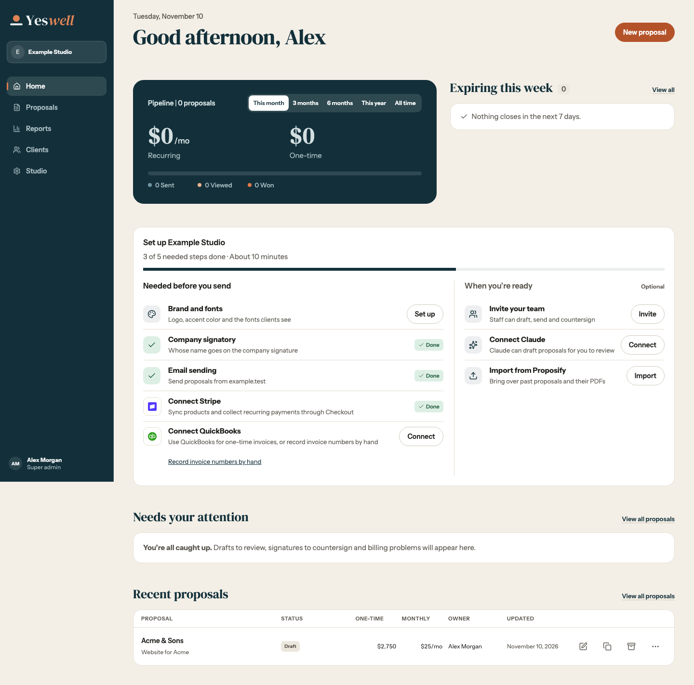
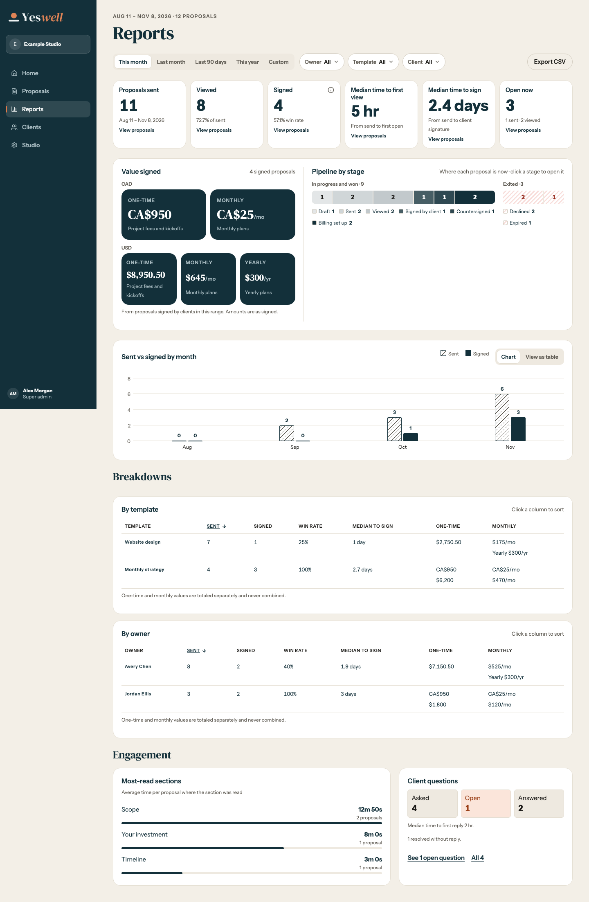
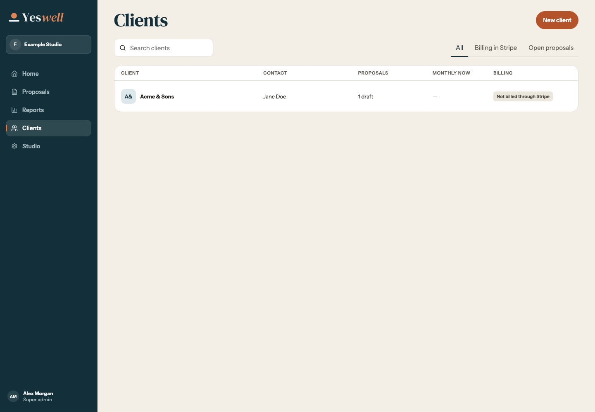
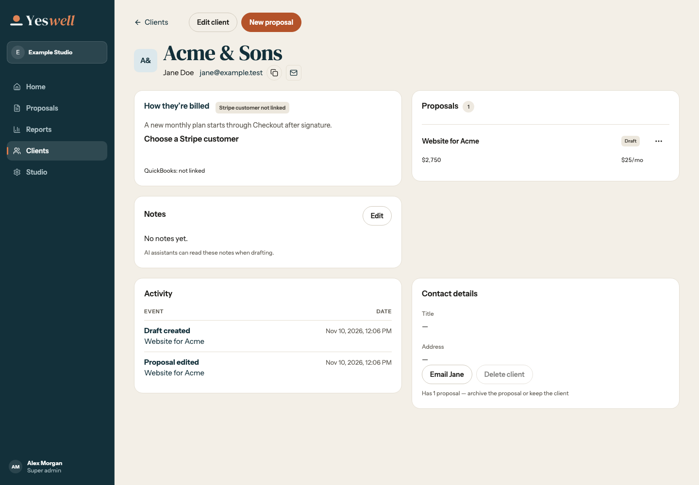
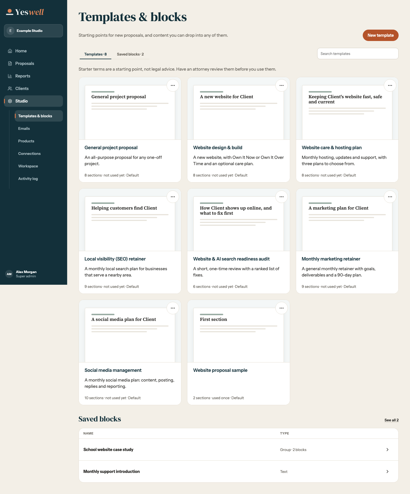
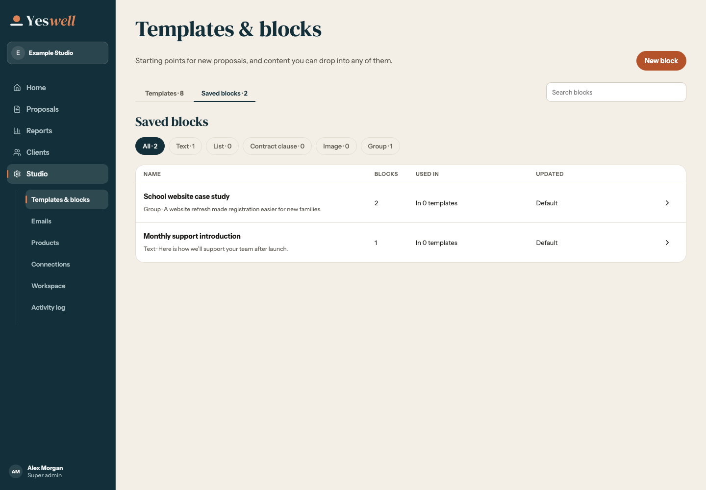
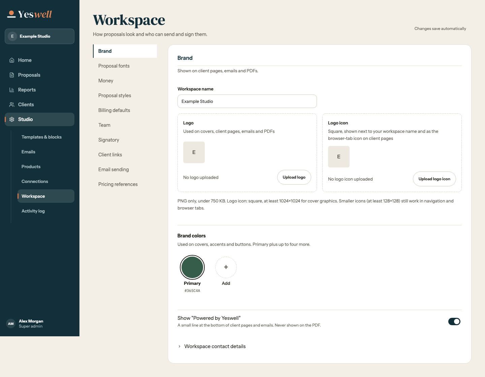

# Staff section headings at 1440 px

The Home reference is Redesign 19 frame 2b1. Its serif section heading is shared by headings on the page background. Direct card titles on the Clients record and Workspace stay in Instrument Sans.

| Home reference         | Reports                                                                    |
| ---------------------- | -------------------------------------------------------------------------- |
|  |  |

| Home reference         | Clients                                |
| ---------------------- | -------------------------------------- |
|  |  |

| Home reference         | Client record                                                        |
| ---------------------- | -------------------------------------------------------------------- |
|  |  |

| Home reference         | Templates & blocks                                             |
| ---------------------- | -------------------------------------------------------------- |
|  |  |
|  |                      |

| Home reference         | Workspace                                   |
| ---------------------- | ------------------------------------------- |
|  |  |

The same heading precedes the records in [Emails](emails-1440.png) (R19 2e5), the provider cards in [Connections](connections-1440.png) (R19 2e8), and the dates in [Activity log](activity-1440.png) (R19 2e14).
