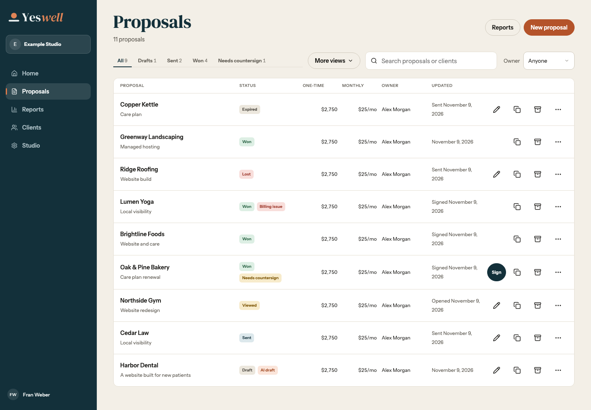
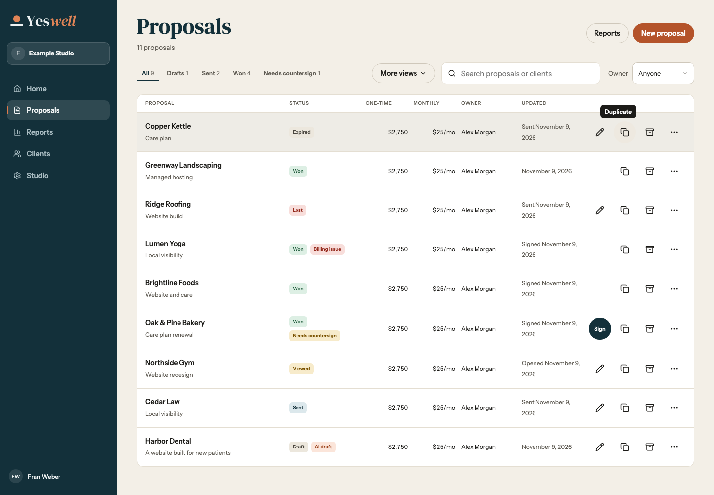
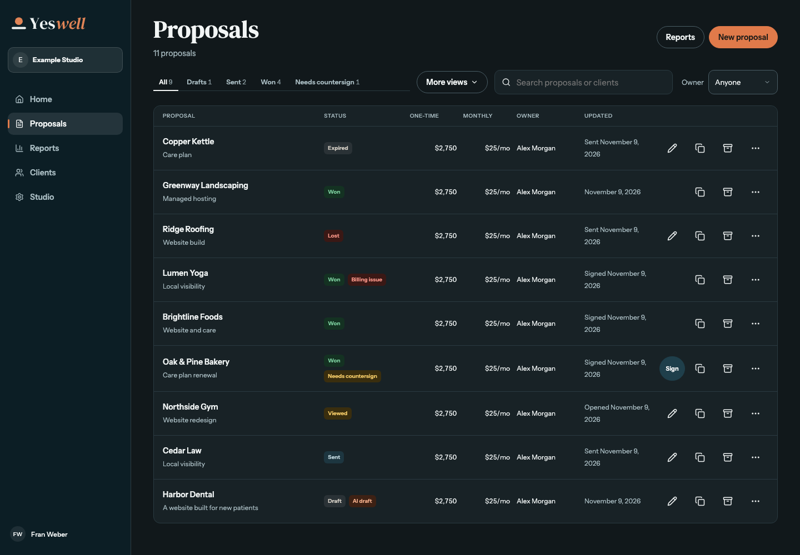
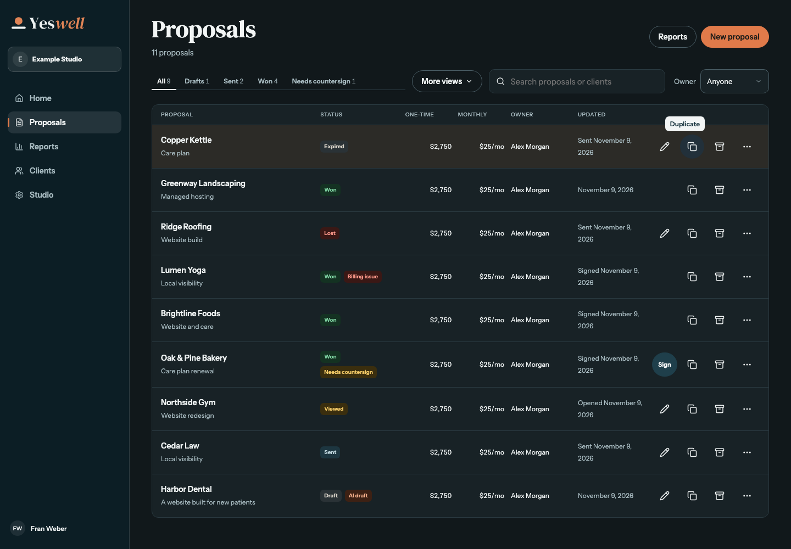
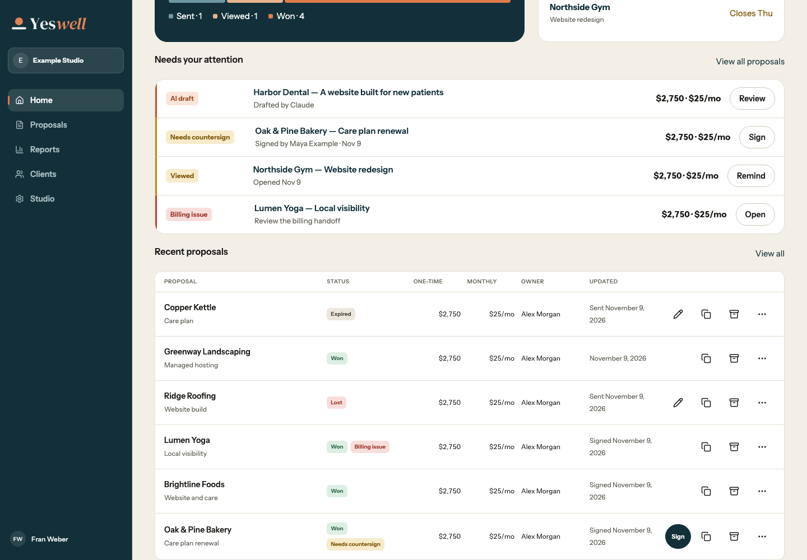
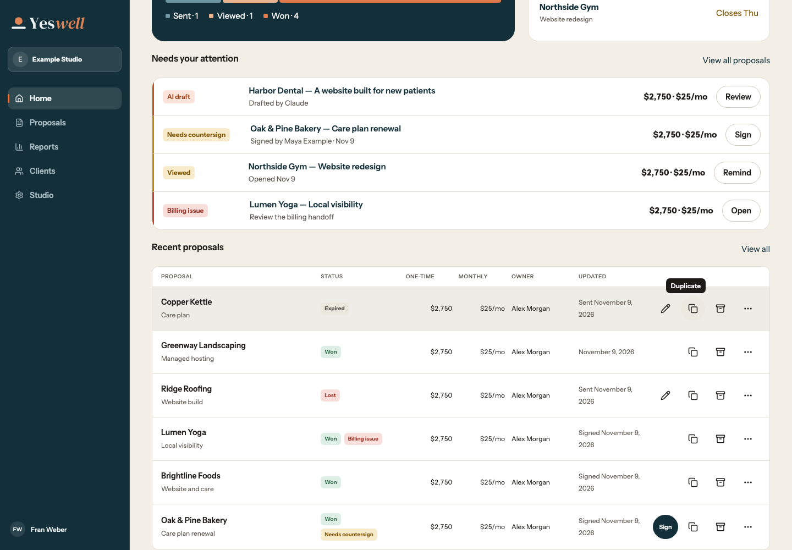
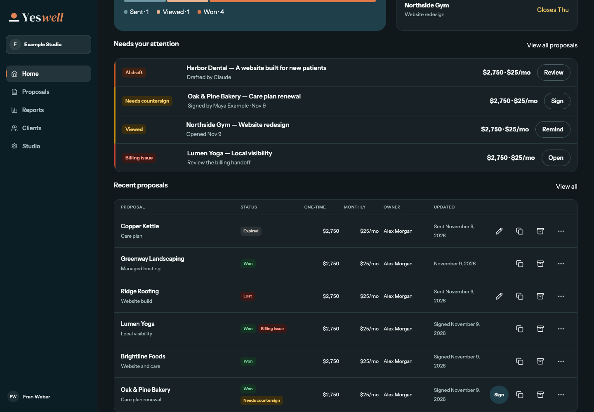
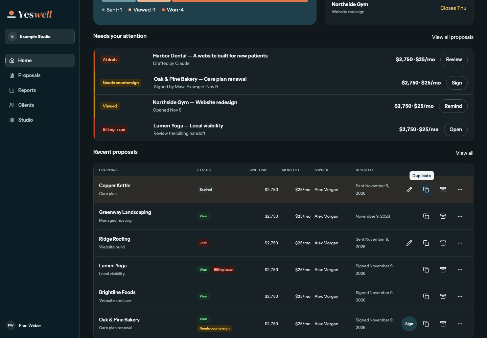

# Shared proposal tables and row actions

All screenshots are at 1440px. Home uses the same table as Proposals and displays its six most recent rows. Hover shows the Duplicate tooltip and circular background.

| Table | Light at rest | Light hovered | Dark at rest | Dark hovered |
| --- | --- | --- | --- | --- |
| Proposals |  |  |  |  |
| Home · Recent proposals |  |  |  |  |
